<p align="center">
  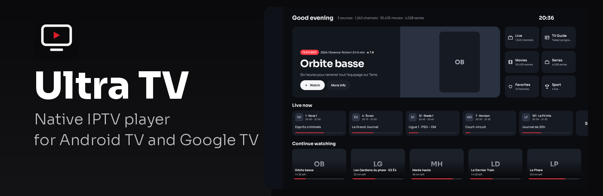
</p>

<h1 align="center">Ultra TV</h1>

<p align="center">
  <strong>Free, open-source IPTV player for Android TV, phones, tablets, Windows and Mac — no ads, no account, built for the remote.</strong>
</p>

<p align="center">
  <a href="https://github.com/vantaflow/ultra-tv/actions/workflows/ci.yml"></a>
  <a href="https://github.com/vantaflow/ultra-tv/releases/latest"></a>
  <a href="LICENSE"></a>
  <a href="https://vantaflow.github.io/ultra-tv/en/"></a>
</p>

<p align="center">
  <a href="README.md">🇫🇷 Version française</a> ·
  <a href="https://vantaflow.github.io/ultra-tv/en/">Website</a> ·
  <a href="https://github.com/vantaflow/ultra-tv/releases/latest/download/UltraTV.apk">Download the APK</a> ·
  <a href="https://github.com/vantaflow/ultra-tv/releases">Releases</a> ·
  <a href="CHANGELOG.md">Changelog (French)</a>
</p>

---

## Download

| Device | Link |
|---|---|
| **Android TV, Google TV, boxes, Fire TV**, Android phones and tablets (Android 9+) | [UltraTV.apk](https://github.com/vantaflow/ultra-tv/releases/latest/download/UltraTV.apk) · on a box: Downloader app, code **`5248504`** |
| **Windows** (x64) | [.exe installer](https://ultratv-config.khalilbenaz.workers.dev/download/windows) |
| **Mac** (Apple Silicon and Intel) | [.dmg disk image](https://ultratv-config.khalilbenaz.workers.dev/download/mac) |
| **Linux** (x86_64) | [AppImage](https://ultratv-config.khalilbenaz.workers.dev/download/linux) |

Automatic updates afterwards, on every platform. No account needed.


Ultra TV plays your own IPTV subscriptions (**Xtream Codes**, **M3U / M3U8** as a link or a file, **Stalker / Ministra portals** by MAC address). The whole interface is native and built for the remote; the catalogue (channels, movies, series, guide, history, favourites) lives in a local Room database. It provides **no content** at all.

> The screenshots below use **synthetic data** (a local fake Xtream server, `android-native/tools/fake-xtream`). Channel and programme names come from that data set, not from the app. The French README shows screenshots taken on a real Android TV box.

<p align="center">
  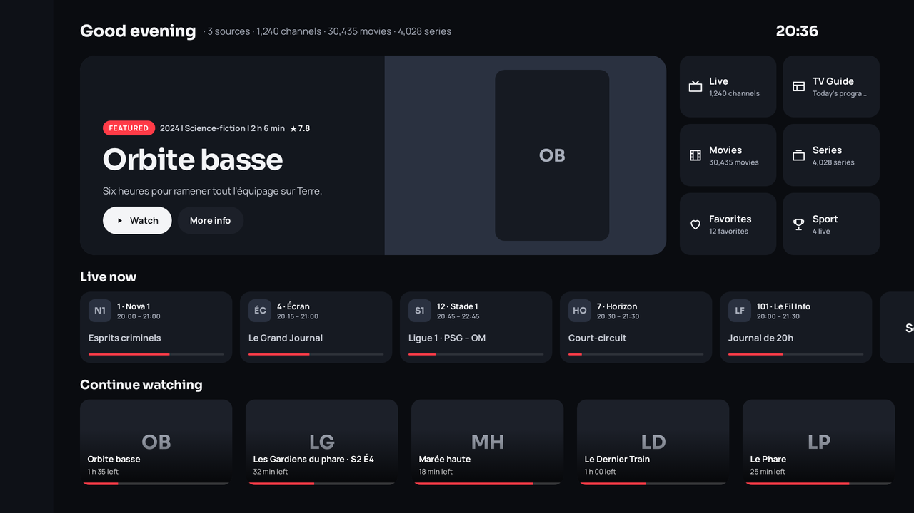
  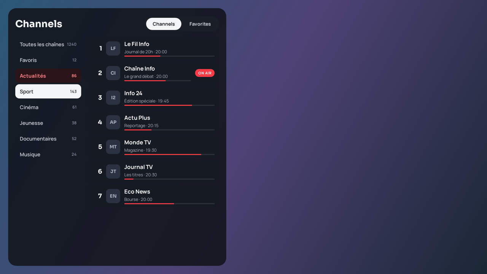
  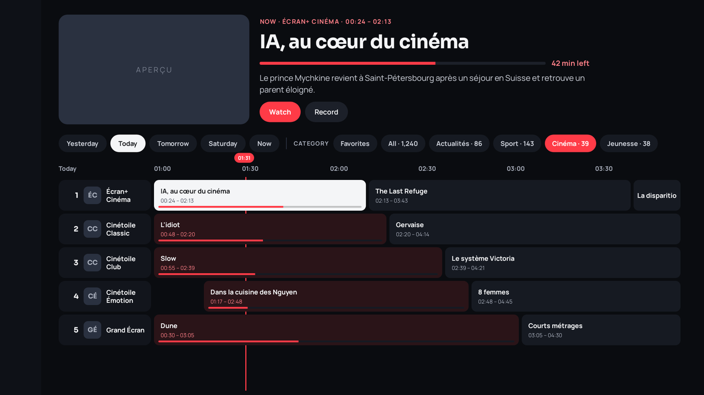
  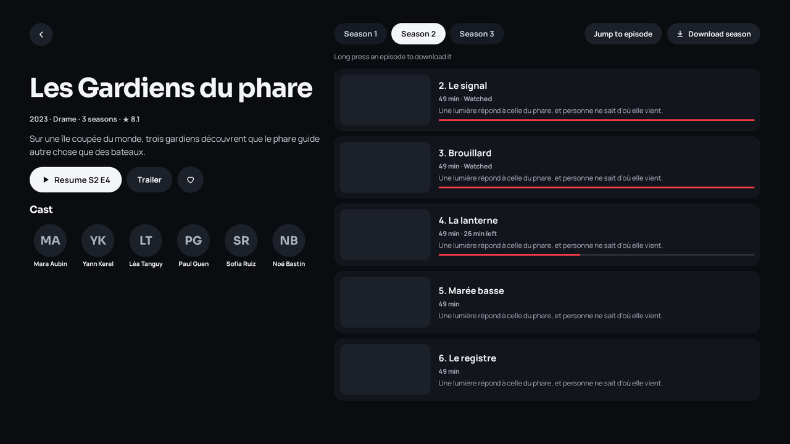
  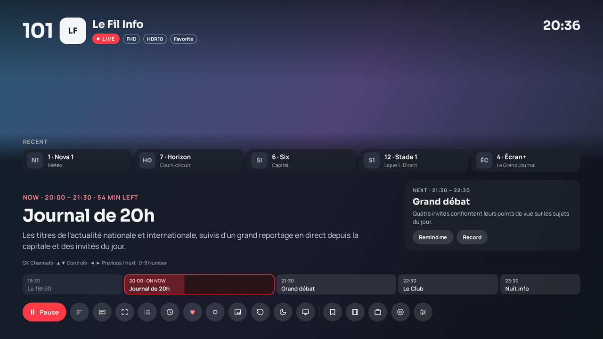
  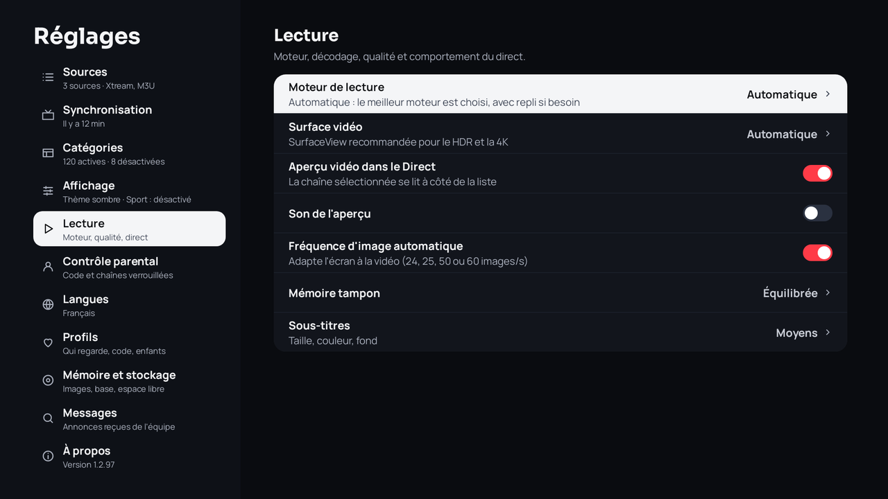
  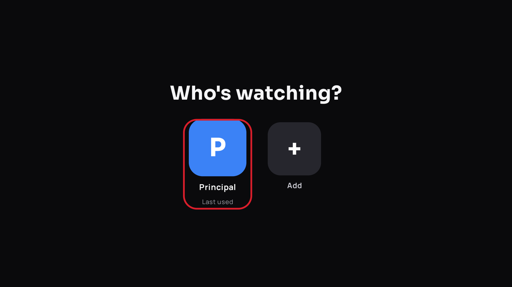
  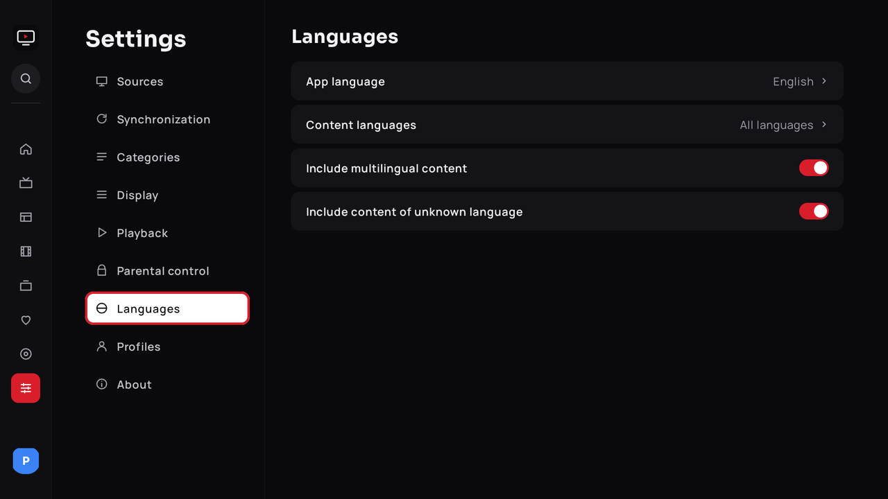
</p>

The same screenshots exist in French ([`docs/screenshots/fr`](docs/screenshots/fr)) and in Arabic, with a mirrored interface ([`docs/screenshots/ar`](docs/screenshots/ar)).

## Features

- **Search** from any screen: a button at the top of the side rail, plus the remote's Search and microphone keys.
- **Live TV**: **video preview** of the selected channel in the list (with sound, adjustable delay), **OK switches it to full screen without reloading the stream**; Up/Down zap, **OK opens the channel list**, Channel +/− and TV keys of Google TV remotes; channel and programme banner; number zapping, Back returns to the menu (Last channel key recalls the previous one), 20 recent channels, instant search (FTS).
- **Categories**: names and playlist order exactly as the source provides them, enable / disable / reorder, text filter ("FR" = whole word); quality badges (SD, HD, FHD, 4K, RAW, HEVC…) to tell apart streams of the same channel.
- **Guide**: time grid, reminders, scheduled recordings, **replay** (Xtream catch-up) from the guide when the source allows it. Programme borrowed from a channel with the same name when the provider only tags one category (HEVC, General…), "+1 / +2" channels shifted accordingly, the provider's short EPG as a fallback, and a **free additional guide** (XMLTV France by default, epgshare01 beIN Sports / Saudi Arabia / UAE) for channels still without a programme.
- **Live pause** (timeshift): circular disk buffer for MPEG-TS streams.
- **Movies and series**: rich details through **TMDB** (poster, plot, cast), **automatic resume** (position saved every 30 s), seasons as tabs, rows by category.
- **Skip intro**: “Skip intro”, “Skip recap” and “Next episode” buttons during intros and credits, from [TheIntroDB](https://theintrodb.org) (community database, no key).
- **IMDb / Rotten Tomatoes ratings** on detail pages (OMDb through the Worker), **actor and director pages** (their titles found in your playlist).
- **Home**: rotating “Featured” banner, “Because you watched…” and “Top rated movies / series” rows; movie and series **filters** (sort, minimum rating, decade); **typo-tolerant search** (“brekin bad” → Breaking Bad).
- **Send from your phone, no account**: the TV shows a QR code and a code; type the playlist (Xtream, M3U or Stalker) on your phone or computer (the Worker's `/envoyer` page) and the TV adds and syncs it. No more typing with the remote.
- **Phone remote and search** (Settings › Sources): the box serves a page on the local network (QR code) to search movies, series and channels and control playback; off by default, protected by a key.
- **Simple mode**: six large tiles (Live TV, Resume, Movies, Series, Favorites, Search), per profile.
- **Memory & storage**: detailed storage use, RAM, cache and database clean-up, memory-saving mode for modest boxes.
- **Hidden categories are never loaded**: a disabled category (by its language or by hand, separately for Live, Movies and Series) is neither stored nor indexed: faster sync, less memory.
- **Movies and series by automatic genres**: category or detected-genre list (Action, Comedy, Anime…) with title counts, poster grid, sorting and filters.
- **Downloads** (Android): movies, episodes or a whole season; queue with pause, resume, cancel and retry, resume after a dropout, optional Wi-Fi only; a « Downloads » screen that works offline.
- **Two playback engines**: ExoPlayer (Media3) and **LibVLC**; Auto / ExoPlayer / VLC, decoding Auto / Hardware / Software, automatic fallback and per-channel memory.
- **Subtitles**: online search (OpenSubtitles through the Worker), advanced style (size, colour, background, outline, position, offset). Nothing to set up on the device; a personal OpenSubtitles account can be linked from the cloud dashboard if needed.
- **Trakt**: movies and episodes you watch are sent to Trakt (watching, then watched at the end); on Home, your Trakt **watchlist**, **recommendations**, **trending**, **popular**, **personal lists** and **Up next**, limited to titles available in the loaded playlist; a **"Watched"** mark; from detail pages: add / remove from the watchlist, mark watched / unwatched (movie, episode, season), **rate 1–10**; resume positions imported. Connect from the cloud dashboard, nothing to set on the TV.
- **Profiles**: "Who's watching?", Kids profile, per-profile favourites, history and languages.
- **Subscription** (menu): your IPTV subscription as reported by the provider — status, expiry date and days left, connections in use / allowed, trial account, server. Android, Windows and macOS.
- **Google TV, Android TV and third-party launchers**: "Continue watching" (movies, episodes and recent live channels, cleaned titles, one tile per movie), **Favorites** home channel (favourites then recent channels) and **New releases** channel (latest movies and series added, no duplicates), voice and global search, `ultratv://` deep links. These rows go through Android's TV provider, so launchers that read it (Kairo…) show them too.
- **Playback**: no sleep during a movie or live TV, pauses when you leave the app (no background audio); clock without offset and adjustable time zone (Settings › Display).
- **Themes** Dark / Light / Automatic (the player always stays dark); interface in English, French, Spanish and Arabic (RTL).
- **Personalisation** (Settings › Display): **accent colour** (6 choices), **text size**, **Home rows** (show, hide, reorder), **start screen** (Home, Live, Movies, Series, Guide or last channel).
- **Custom DNS** (Android and desktop): Google, Cloudflare, Quad9, DNS-over-HTTPS or your own server; applied to catalogue, guide, images and streams (on Android: ExoPlayer streams, not VLC; Test button), automatic fallback to the system DNS.
- **Sleep**: 30 / 60 / 90 min timer or end of programme; built-in update from GitHub releases.

## Devices

One account, all your screens: same interface, same provider everywhere. Add it once in the [cloud dashboard](#cloud-sync) and every device receives it.

### Android TV and Google TV

The original app, driven by the remote (see the screenshots above and [Features](#features)).

### Android smartphone

Touch interface: bottom navigation bar, lists and grids by finger, gesture player with picture-in-picture; forms sit above the keyboard.

<p align="center">
  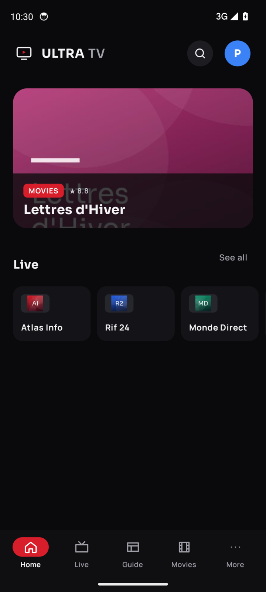
  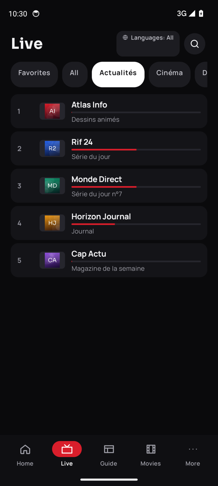
  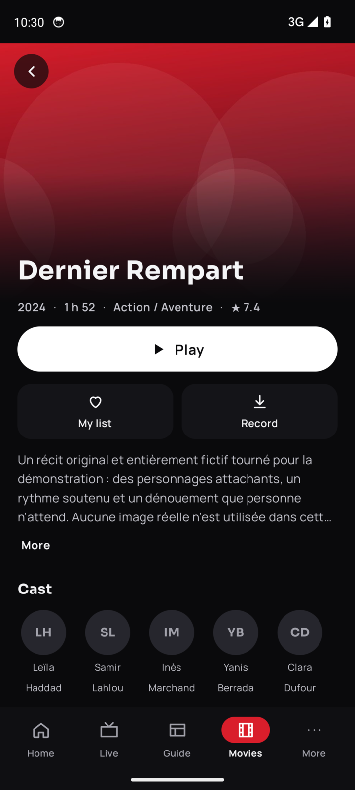
  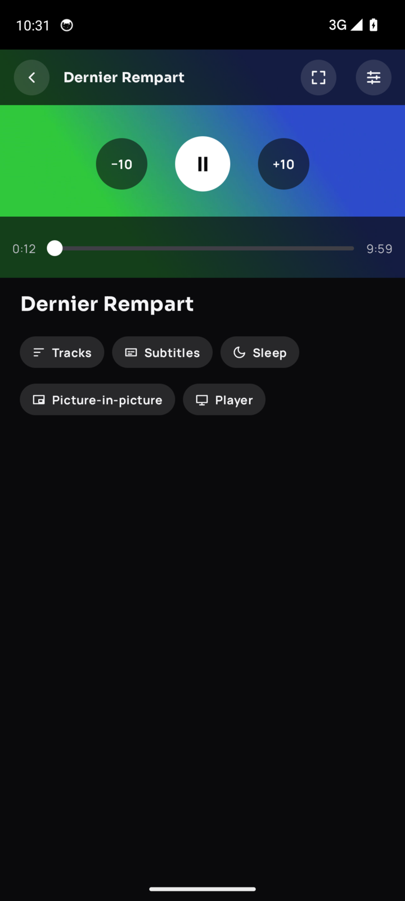
</p>

### Android tablet

Side rail, list and details side by side.

<p align="center">
  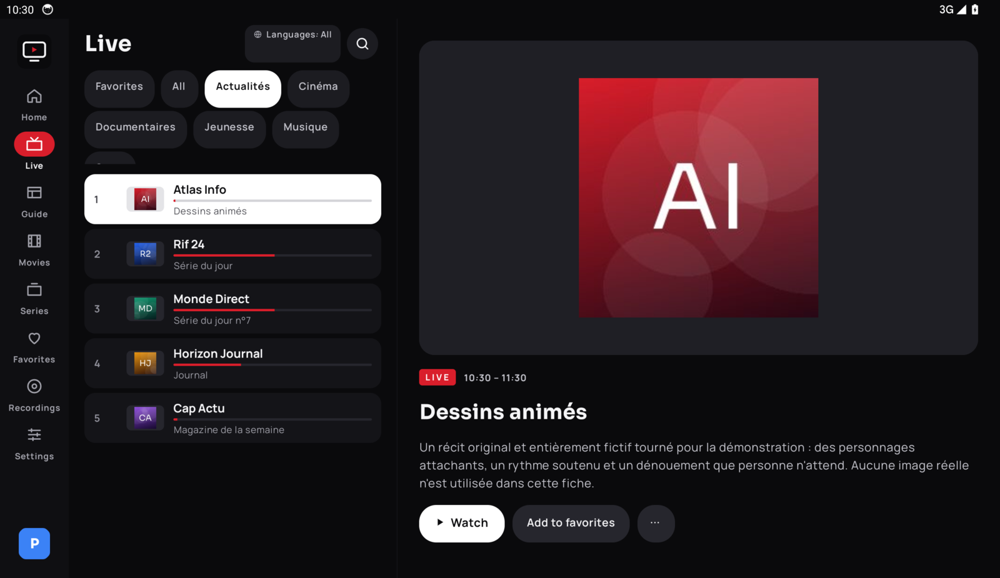
  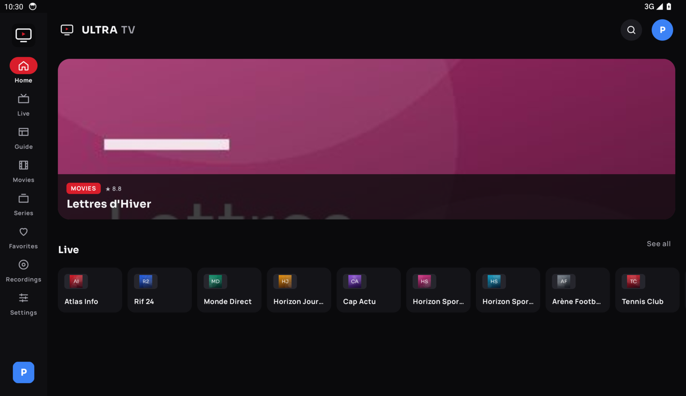
</p>

### Windows and macOS

The same design on desktop: the web app in [`web/`](web/README.md) packaged with Electron ([`electron/`](electron/README.md)). On the web, only the management dashboard is offered (no player). Xtream Codes and M3U (link or file); catalogue kept locally (IndexedDB), credentials encrypted with the system keychain, direct playback (no remote proxy), automatic updates through GitHub Releases. **Search**: round button under the logo, shortcut `Ctrl/Cmd + K` or `/` from any screen.

<p align="center">
  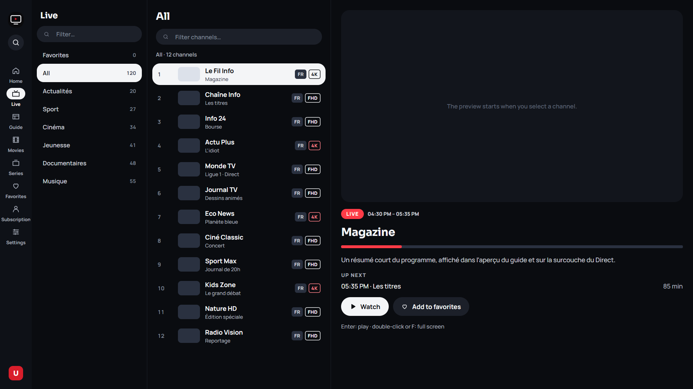
  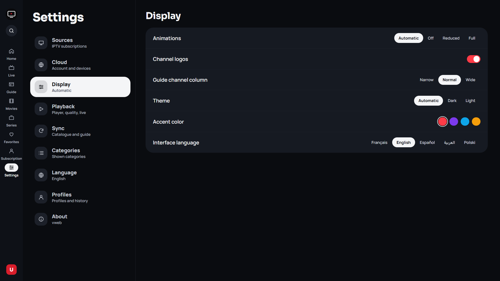
</p>

All desktop screenshots (synthetic data, FR and EN): [`docs/screenshots/desktop/`](docs/screenshots/desktop/). Release: `desktop-vX.Y.Z` tag (workflow `desktop-release.yml`, separate from the Android `v*` tags).

### Cloud dashboard

Manage devices and sources from a browser: **<https://ultratv-config.khalilbenaz.workers.dev>**.

<p align="center">
  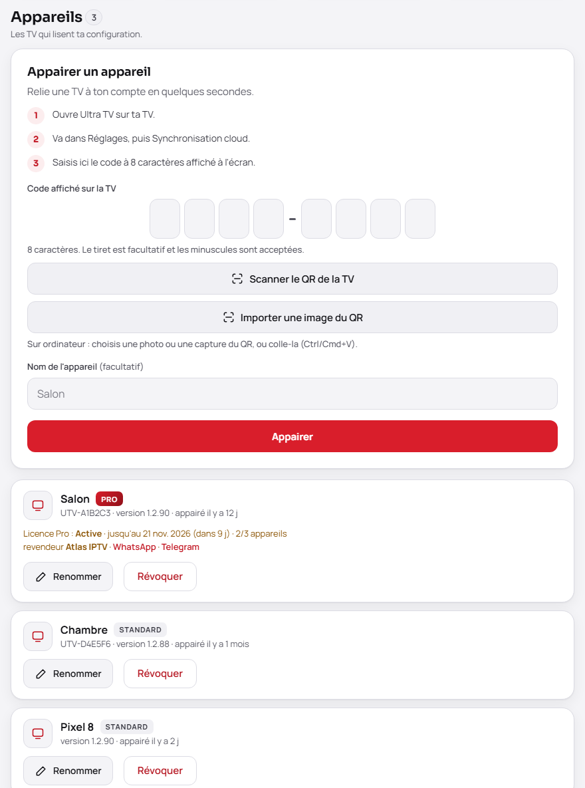
  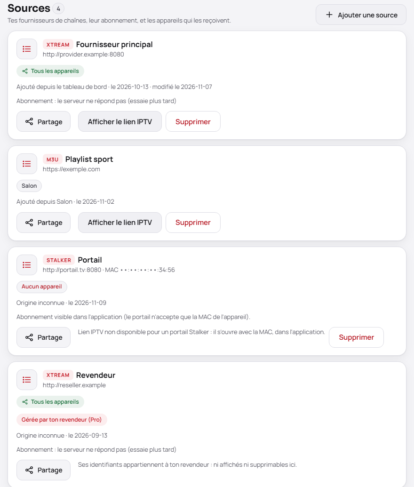
</p>

**Xtream**, **M3U** and **Stalker portal** sources (MAC address masked). Each device shows its model, edition, **app version** and last activity. Each Xtream or M3U source has a **Show IPTV link** button (full M3U link, on demand, with a Copy button) and its **subscription** (status, expiry date, days left, connections), read from the provider; lists are paginated and searchable as they grow.

**Account** section:
- **Trakt**: *Connect Trakt* button, authorise on Trakt; your devices then send what you watch. Your Trakt password never goes through the site.
- **Subtitles · OpenSubtitles** (optional): link your OpenSubtitles account, free or VIP, to use your own download quota instead of the shared one.

Pair in one scan: the TV shows a QR, the phone camera opens the pairing page with the code already filled in. The code can also be typed by hand, with or without the dash.

<p align="center">
  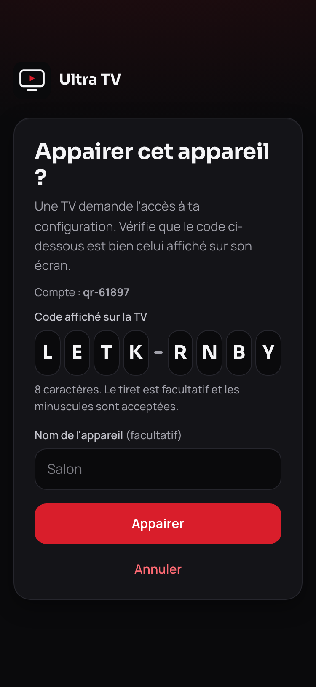
  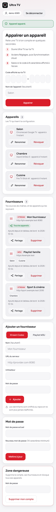
</p>

### Multi-device sync

- **Same provider everywhere**: a provider added in the dashboard is received by every device on the account.
- **Device-only source**: a source added on a device stays private to it until you share it.
- **Sharing chosen per device**: source by source, tick the receiving devices (in the app: Settings › Sources › *Share this source*; or in the dashboard).
- **Shared categories**: enabling or disabling a category on one device applies to the others (latest change wins).
- **Shared favourites, resume points and recently watched**: a movie started on the TV resumes at the same spot on the Mac; a favourite added or removed is everywhere. Per account source, profiles matched by name.
- Account changes are serialized on the Worker (Durable Object lock): two devices writing at once do not overwrite each other.

## Downloads

| Device | File |
|---|---|
| Android (TV, smartphone, tablet) | universal [`UltraTV.apk`](https://github.com/vantaflow/ultra-tv/releases/latest/download/UltraTV.apk), or one APK per CPU `UltraTV-<version>-<abi>.apk` (`arm64-v8a`, `armeabi-v7a`, `x86_64`) with its precompiled profile `.dm`, plus `SHA256SUMS.txt` |
| macOS | `UltraTV-<version>-mac-universal.dmg` (Apple Silicon and Intel) |
| Windows | `UltraTV-<version>-win-x64.exe` (NSIS installer) |
| Cloud dashboard | <https://ultratv-config.khalilbenaz.workers.dev> (nothing to install) |

Everything is on the [Releases](https://github.com/vantaflow/ultra-tv/releases) page (desktop files carry `desktop-v…` tags).

## Installation

Android 9 or newer (API 28).

**APK.** Download [`UltraTV.apk`](https://github.com/vantaflow/ultra-tv/releases/latest/download/UltraTV.apk) (SHA-256 sum on the release page) and install it. Lighter per-processor builds (`UltraTV-<version>-arm64-v8a.apk`, `armeabi-v7a`, `x86_64`) are published with a `SHA256SUMS.txt`; the in-app updater picks the right one for your device.

**Downloader** (boxes without a browser): open the [Downloader](https://www.aftvnews.com/downloader/) app, enter the code **`5248504`**, allow unknown sources, install.

**adb**:

```bash
adb connect BOX_IP:5555
adb install -r UltraTV.apk
```

**adb, faster startup** (Android 12 or newer): install your processor's APK together with its precompiled profile `.dm` (same name, published in the release). Android then compiles the app at install time instead of waiting for a background optimisation. Measured on a 2 GB box: startup 1.1 s → 0.6 s, noticeably smoother scrolling.

```bash
adb install-multiple -r UltraTV-<version>-armeabi-v7a.apk UltraTV-<version>-armeabi-v7a.dm
```

On first launch: choose the source type (Xtream Codes, M3U link, M3U file, **Stalker portal** or **From the cloud**), enter it, then choose your categories (only active categories are downloaded).

An address like `…/get.php?username=…&password=…` pasted as an M3U link is recognised and added as an Xtream Codes source (many providers block `get.php`).

## Cloud sync

To avoid typing credentials with a remote, manage your sources from a browser: **<https://ultratv-config.khalilbenaz.workers.dev>** (the address is also shown in the app, with a QR code: Settings › Sources).

1. Create an account on the dashboard and add your sources.
2. In the dashboard, choose **Pair a TV**.
3. On the box: **From the cloud** (Source step of the wizard) or Settings › Sources › *Sync from the cloud*. An 8-character code is displayed; enter it in the dashboard.
4. The box imports the configuration, then syncs.

The device receives a random 256-bit token (hashed on the server, encrypted in the Keystore, revocable). Your credentials are **encrypted on the server side** (AES-256-GCM). The label shown for the box ("UTV-XXXXXX") is only a name, never a key.

**Self-hosting.** You can deploy your own Worker (see [Cloudflare Worker](#cloudflare-worker)): create the KV namespaces, set the `SESSION_SECRET`, `PROVIDER_ENC_KEY` and `OPS_TOKEN` secrets (no value is published here), then `wrangler deploy`; in the app, Settings › Sources › *Dashboard address* then points to yours.

## Security

- Source credentials **encrypted at rest** on the device; AES-256-GCM on the Worker.
- **No stream URL and no credential is displayed** or logged; error messages are filtered (`UserText`). An empty source name does not fall back to the server address.
- No shared token in the APK. Details, threat model and rotation of old secrets: [SECURITY.md](SECURITY.md).

## Privacy

Ultra TV provides **no content**: you add your own sources (Xtream Codes, M3U, Stalker portal) and the app talks directly to your provider. It contains no ads and no third-party analytics library. The "Worker" is the cloud configuration server ([`cloudflare-config/`](cloudflare-config/)), hosted on Cloudflare; its address can be changed in Settings › Sources › *Dashboard address*.

### Your IPTV credentials

The server address, username, password, stream URLs and the MAC of a Stalker portal are sent **only to your provider**, except in two intended cases:

- **Cloud sync**: on a paired device, a source is sent to the Worker only if you share it (offer shown after adding, or the share button) or add it from the dashboard. It is stored **encrypted** (AES-256-GCM, server-side encryption with a Worker secret key: not end-to-end). When you open the dashboard, the Worker itself queries your provider with these credentials to show the subscription status. If your provider blocks Cloudflare servers, this request goes through a relay hosted on Vercel (code in [`cloudflare-config/relay/`](cloudflare-config/relay/)): it receives the address and credentials for that request only and does not store them.
- **Send from your phone**: the source typed on the web page is encrypted, kept for 15 minutes at most and deleted as soon as the TV receives it.

Logs and crash reports are scrubbed (`username`, `password`, `token`… parameters, `user:password@`, `/live/user/password/` paths) in the app, then again by the Worker. Limit: a server's domain name can remain in an error message. Adding a Stalker source only sends journey events ("add attempt", success or failure, error class), never the portal's host name.

### What the Android app sends on its own

| What | When | To | Content | Turned off by the setting |
|---|---|---|---|---|
| Anonymous install count | ≈ 10 s after start, at most once per 20 h, **unpaired** device | Worker `/api/anon/ping` | random install ID, version | Yes |
| Diagnostic logs | during use, **paired** device | Worker `/api/event` | level, tag, scrubbed message (start, screen shown, smoothness metrics, freezes, key counters, Google TV, update, sync failures), version, model, device label | Yes |
| Crash reports | on crash (or next start), **paired** device | Worker `/api/crash` | scrubbed stack trace, version, model, Android version | Yes |
| Update check | 30 s after each launch, or on request | `api.github.com`, then GitHub | request without identifier; if a newer version exists the APK is downloaded and Android's installer asks for confirmation | **No** |
| Alerts (read) | on open, then every 15 min in the foreground | Worker `/api/announcements` | screen type, version | **No** |
| Alerts (statistics) | alert shown, dismissed or button used | Worker `/api/announcements/<id>/stat` | event type, random install ID | Yes |
| Extra guide | during guide sync, if channels have no programme | `xmltvfr.fr` (default) | file download; changeable: Settings › Synchronization | No |
| Skip intro | when opening a movie/episode (TMDB id known) | `api.theintrodb.org` | TMDB id, season, episode, duration | **No** |
| TMDB details, ratings | when opening a details page, **paired** device | Worker `/api/tmdb`, `/api/ratings` | cleaned title, year, language, or TMDB id | **No** |
| TMDB posters | on display | `image.tmdb.org` | image request | **No** |
| Online subtitles | only on *Search online*, paired device | Worker `/api/subtitles` | title, languages, year | **No** |
| Cloud sync | paired: at launch, every 6 h; favourites and history ≈ 60 s after a change then every 10 min | Worker | device token, version, edition; display settings; favourites and history per profile (title, poster address, position, duration) | **No** (unpairing stops it) |
| Trakt | while playing a movie/episode, paired device | Worker `/api/device/trakt` | action, progress, title, year, TMDB ids, season, episode | **No** |
| DNS | only if you pick a DNS other than the system one (Settings › Playback) | Google, Cloudflare, Quad9 or yours | domain names | No |

Images supplied by your source are loaded directly from the addresses it gives.

### Windows and macOS

No anonymous count, crash report, remote log or alerts. Sends: update check (`api.github.com`, 5 s after launch then every 6 h; on by default, it can be turned off in Settings › About › *Check for updates automatically*, the manual check button stays usable), cloud sync, Trakt, TMDB and ratings through the Worker (paired device), "Skip intro", fallback posters and the chosen DNS.

### What the Worker keeps

- **Account**: login, PBKDF2 password hash, country (code supplied by Cloudflare), dates; until the account is deleted. **Devices**: token hash, name, model, version, country, last activity.
- **Sources, Trakt and OpenSubtitles tokens, shared favourites and history**: encrypted, until deleted.
- **Diagnostic logs**: 7 days; **crash reports**: 30 days. They hold device ID, an account fingerprint (non-reversible HMAC, never the account ID or e-mail address), country, version, model, a device label derived by hashing the Android ID.
- **Anonymous count**: hash of the install ID, dates, version, country; 180 days. **Alert statistics**: hash, up to 31 days after the alert ends.
- **Send from phone**: 15 min at most. **Pairing code**: 10 min.
- **IP address**: not written to any stored data; used only to count requests (rate limiting) in counters that hold no address and expire on their own.

### Turning telemetry off

**Settings › About › *Telemetry and crash reports*** (on by default). Off: no more diagnostic logs, crash reports, anonymous count or alert statistics, and no install ID in send-from-phone. It does **not** turn off the update check, reading alerts, cloud sync, Trakt, TMDB, subtitles, "Skip intro", the extra guide or DNS. Without pairing, no log or crash report is sent anyway.

## Automatic tuning

On first launch, the **`AdaptiveProfile`** measures the device (memory, heap, micro-benchmark) and rates it **Low / Medium / High**. From that it derives buffer, parallelism and sync batch size, resolution and bitrate caps (low-memory boxes: 720p / 6 Mb/s) and adjusts the buffer if drop-outs occur. Everything stays adjustable: Settings › Playback (engine, decoding, buffer preset: Low latency, Auto, Balanced, Stable, Custom).

## For developers

Stack: Kotlin · Compose for TV · Media3 (ExoPlayer) + LibVLC · Room · Hilt.

JDK 17 required.

```bash
git clone https://github.com/vantaflow/ultra-tv && cd ultra-tv/android-native
export JAVA_HOME=$(/usr/libexec/java_home -v 17)   # macOS
./gradlew assembleDebug                            # universal APK
./gradlew testDebugUnitTest                        # unit tests (JUnit, Robolectric)
./gradlew assembleRelease                          # per-ABI APKs (arm64-v8a, armeabi-v7a, x86_64)
```

- The version comes from the [`VERSION`](VERSION) file; `versionCode = major×10000 + minor×100 + patch` (1.2.0 → 10200), identical for every ABI.
- **Fake Xtream server** to test without a subscription: `python3 android-native/tools/fake-xtream/server.py` (the emulator reaches it at `http://10.0.2.2:8099`, credentials `test` / `test`); `demo.py` serves the synthetic data set used for the screenshots.
- Debug build: debug intents (`debug_route`, `debug_theme`, `debug_lang`, `debug_engine`, `debug_decoder`, `debug_buffer`…) for screenshots and measurements.
- **CI** ([ci.yml](.github/workflows/ci.yml)): web (tsc + vitest), Android (compile + unit tests), Worker. Publishing: [release.yml](.github/workflows/release.yml) on a `v*` tag (universal `UltraTV-debug.apk`, per-processor `UltraTV-<version>-<abi>.apk` and `SHA256SUMS.txt`); website: [pages.yml](.github/workflows/pages.yml).

## Cloudflare Worker

`cloudflare-config/`: pairing dashboard, encrypted source storage, crash ingestion, TMDB and OpenSubtitles proxies. Full procedure: [cloudflare-config/README.md](cloudflare-config/README.md).

```bash
cd cloudflare-config && npm ci
wrangler kv namespace create CONFIG                # paste the ids into wrangler.toml
wrangler secret put SESSION_SECRET                 # >= 32 random characters
wrangler secret put PROVIDER_ENC_KEY               # AES-256 key, base64
wrangler secret put OPS_TOKEN                      # password for /crashes and /logs
wrangler secret put TMDB_READ_TOKEN                # TMDB v4 read token (rich details)
wrangler secret put TMDB_API_KEY                   # TMDB v3 key (fallback without a v4 token)
wrangler secret put OPENSUBTITLES_API_KEY          # OpenSubtitles key (online subtitles)
wrangler secret put ACCOUNT_RELAY_KEY              # optional: subscription relay outside Cloudflare (cloudflare-config/relay)
npm test && wrangler deploy --dry-run
```

TMDB and OpenSubtitles are optional: without their secrets, the app hides the matching features. Trakt uses `TRAKT_CLIENT_ID` (`wrangler.toml`, Trakt app in PKCE mode: no client secret). For a fork, build with `-PULTRA_WORKER_URL=https://your-worker.workers.dev`.

## Known limitations

- **Replay** and **live pause** depend on the source (Xtream catch-up, MPEG-TS streams); unavailable otherwise.
- TMDB details and online subtitles require a Worker configured with the secrets above.
- An episode started on the TV shows up in "Resume" on the computer once the series has been opened there at least once.
- No free guide covers Moroccan channels (2M, Al Aoula…): only the provider's guide does.
- The first sync of a very large catalogue (≈ 55,000 channels) takes about a minute on a mid-range device and longer on an entry-level one.
- The APK grows with LibVLC (≈ 53 MB in arm64-v8a, against ≈ 9 MB in 1.0.x).
- Measurements published in the release notes come from Android TV emulators (software rendering): to be confirmed on real hardware.

## Licence

MIT, see [LICENSE](LICENSE). Ultra TV is an IPTV client: only use playlists, guides and credentials you are entitled to use. The Sora and Manrope fonts are under the OFL licence.
