<p align="center">
  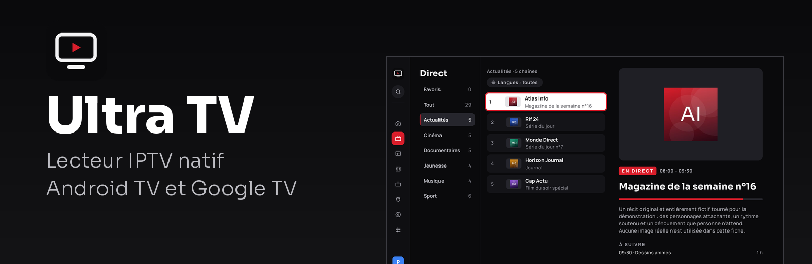
</p>

<h1 align="center">Ultra TV</h1>

<p align="center">
  <strong>Lecteur IPTV natif pour Android TV et Google TV.</strong><br/>
  Kotlin · Compose for TV · Media3 (ExoPlayer) + LibVLC · Room · Hilt
</p>

<p align="center">
  <a href="https://github.com/vantaflow/ultra-tv/actions/workflows/ci.yml"></a>
  <a href="https://github.com/vantaflow/ultra-tv/releases/latest"></a>
  <a href="LICENSE"></a>
  <a href="https://vantaflow.github.io/ultra-tv/"></a>
</p>

<p align="center">
  <a href="README.en.md">🇬🇧 English version</a> ·
  <a href="https://vantaflow.github.io/ultra-tv/">Site</a> ·
  <a href="https://github.com/vantaflow/ultra-tv/releases/latest/download/UltraTV-debug.apk">Télécharger l'APK</a> ·
  <a href="https://github.com/vantaflow/ultra-tv/releases">Releases</a> ·
  <a href="CHANGELOG.md">Changelog</a>
</p>

---

Ultra TV lit vos propres abonnements IPTV (**Xtream Codes**, **M3U / M3U8** en lien ou en fichier, **portails Stalker / Ministra** par adresse MAC). Toute l'interface est native et pilotée à la télécommande ; le catalogue (chaînes, films, séries, guide, historique, favoris) vit dans une base Room locale. Il ne fournit **aucun contenu**.

> Les captures TV ci-dessous viennent d'une **vraie box Android TV** (Android 14, 2 Go de RAM) ; Ultra TV ne fournit aucun contenu. Le lecteur, les profils, les langues et les captures en anglais et en arabe utilisent des **données synthétiques** (faux serveur Xtream local, `android-native/tools/fake-xtream`).

<p align="center">
  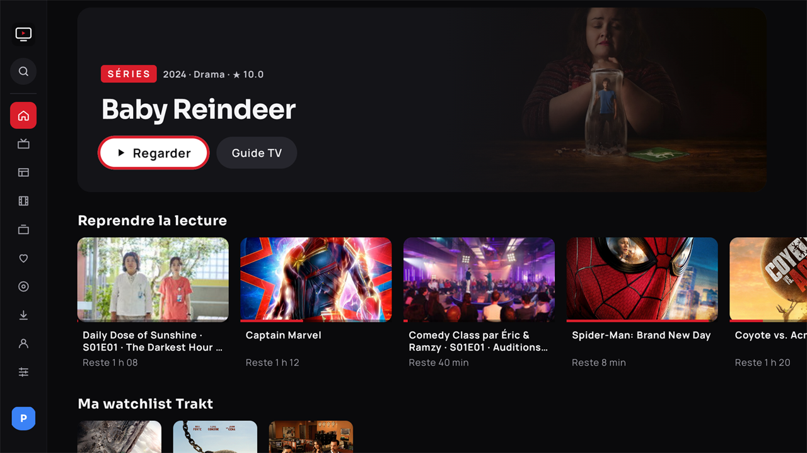
  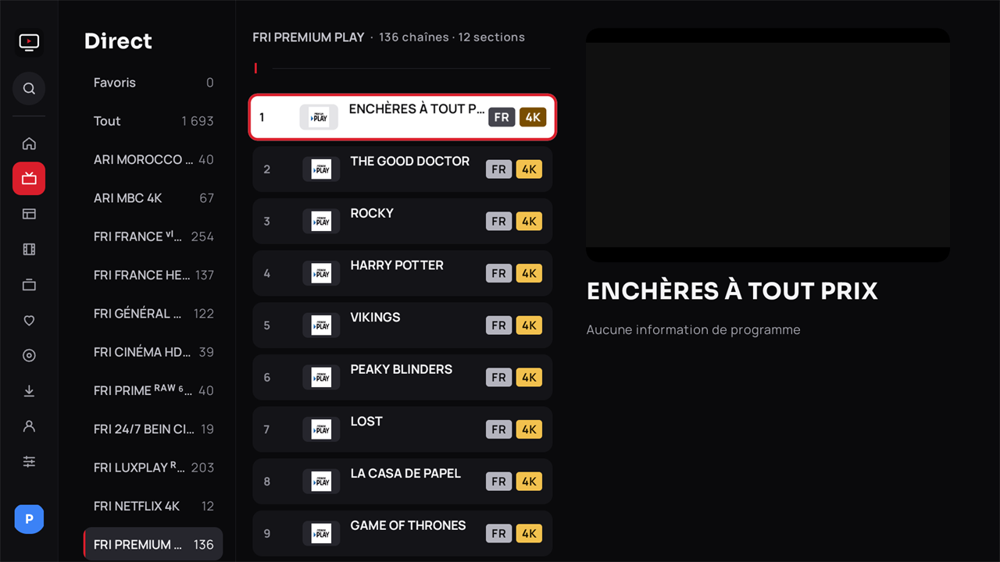
  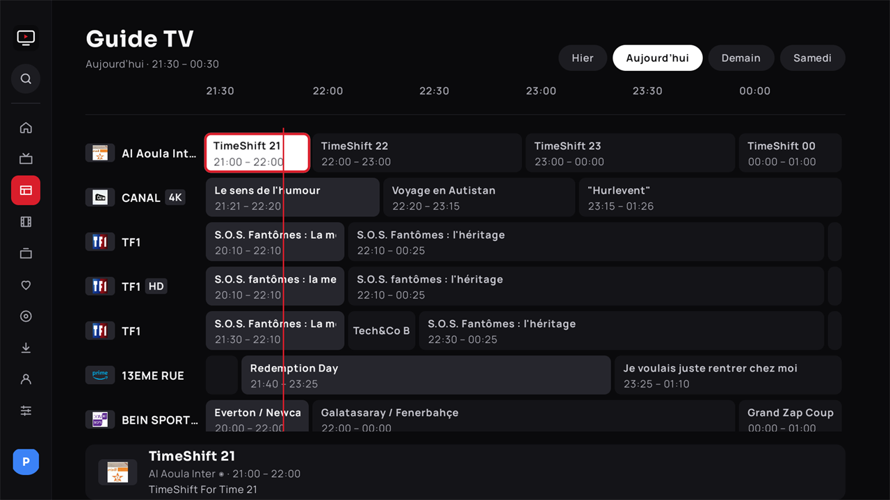
  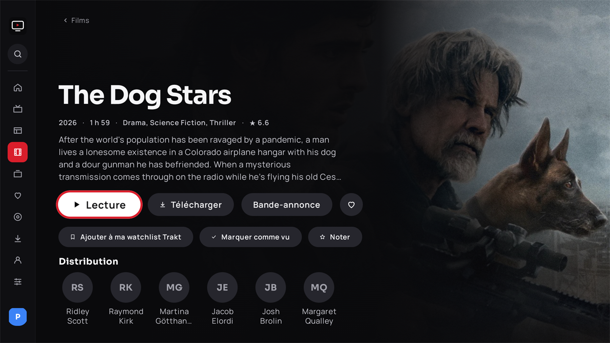
  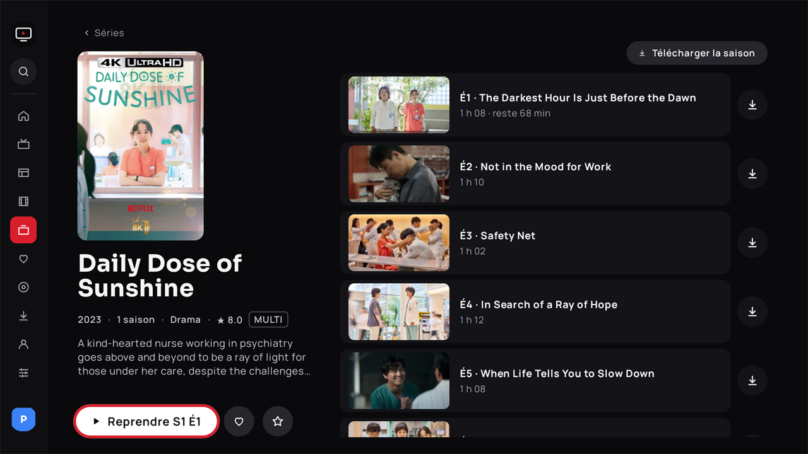
  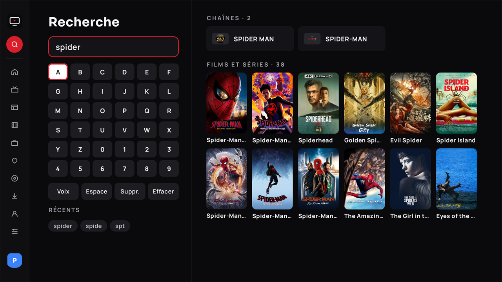
  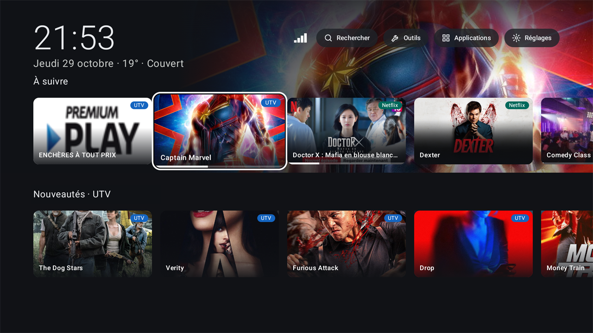
  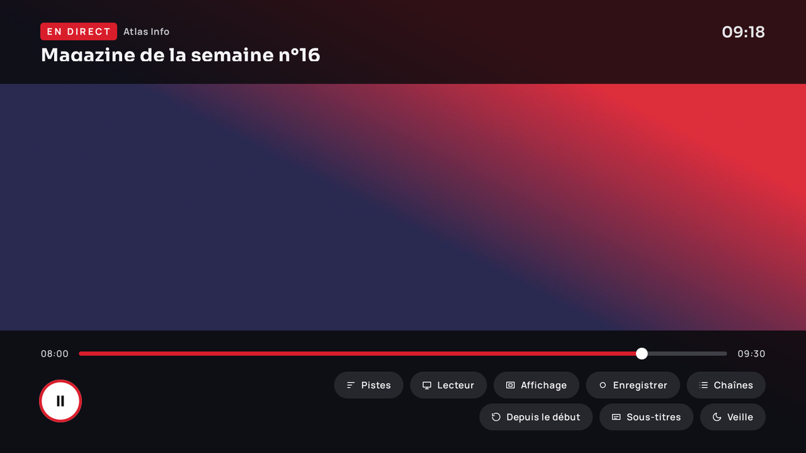
  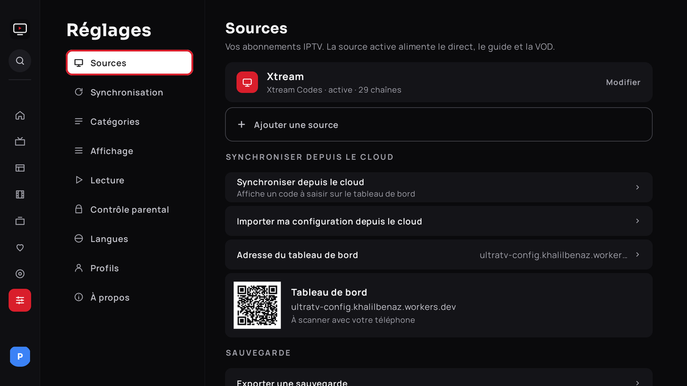
  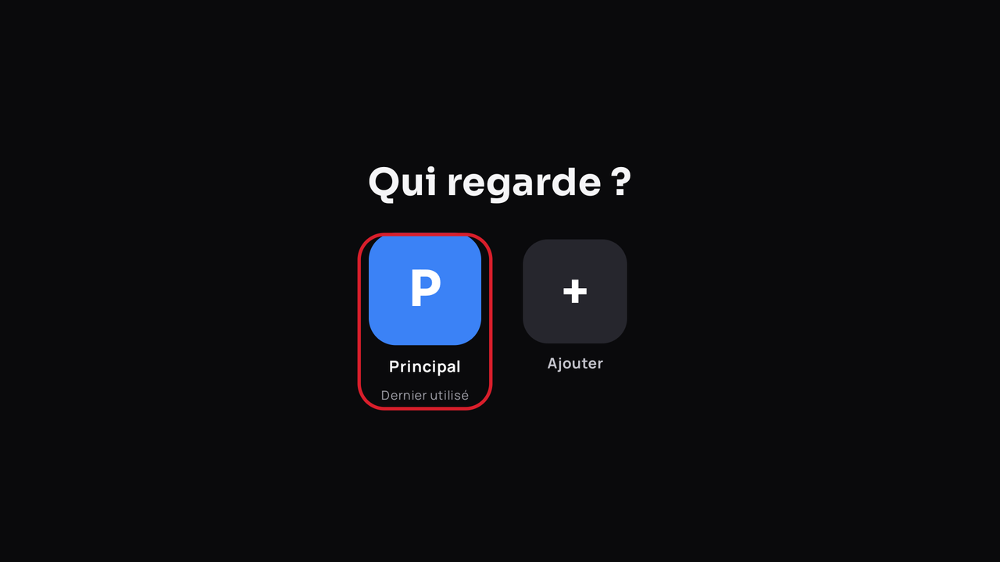
  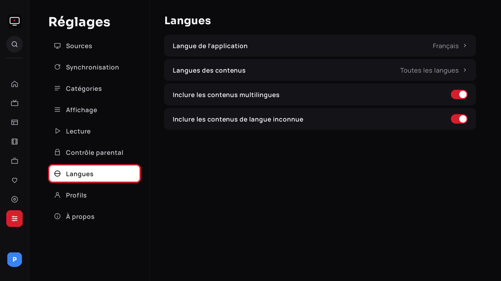
</p>

Captures aussi disponibles en anglais ([`docs/screenshots/en`](docs/screenshots/en)) et en arabe, interface en miroir ([`docs/screenshots/ar`](docs/screenshots/ar)).

## Fonctionnalités

- **Recherche** depuis n'importe quel écran : bouton en haut du menu latéral, touches Recherche et micro de la télécommande.
- **Direct** : **aperçu vidéo** de la chaîne sélectionnée dans la liste (avec le son, délai réglable), **OK la passe en plein écran sans recharger le flux** ; Haut/Bas zappent, **OK ouvre la liste des chaînes**, touches chaîne +/− et TV des télécommandes Google TV ; bandeau chaîne et programme ; zapping par numéro, Retour revient au menu (touche « chaîne précédente » pour la dernière chaîne), 20 chaînes récentes, recherche instantanée (FTS).
- **Catégories** : noms et ordre de la playlist tels que fournis par la source, activer / désactiver / réordonner, filtre texte (« FR » = mot entier) ; pastilles de qualité (SD, HD, FHD, 4K, RAW, HEVC…) pour distinguer les flux d'une même chaîne.
- **Guide** : grille horaire, rappels, enregistrements programmés, **replay** (catch-up Xtream) depuis le guide quand la source le permet. Programme repris d'une chaîne du même nom quand le fournisseur n'en donne qu'à une catégorie (HEVC, Général…), chaînes « +1 / +2 » décalées d'autant, programme court du fournisseur en secours, et **guide complémentaire gratuit** (XMLTV France par défaut, epgshare01 beIN Sports / Arabie saoudite / Émirats) pour les chaînes restées sans programme.
- **Pause du direct** (timeshift) : tampon disque circulaire pour les flux MPEG-TS.
- **Films et séries** : fiches enrichies via **TMDB** (affiche, synopsis, distribution), **reprise automatique** (position enregistrée toutes les 30 s), saisons en onglets, rangées par catégorie.
- **Téléchargements** (Android) : films, épisodes ou saison entière ; file d'attente avec pause, reprise, annulation et nouvel essai, reprise après coupure, Wi-Fi seulement en option ; écran « Téléchargements » utilisable hors ligne.
- **Deux moteurs de lecture** : ExoPlayer (Media3) et **LibVLC**, choix Auto / ExoPlayer / VLC, décodage Auto / Matériel / Logiciel, repli automatique et mémorisation par chaîne.
- **Sous-titres** : recherche en ligne (OpenSubtitles via le Worker), style avancé (taille, couleur, fond, contour, position, décalage). Rien à configurer sur l'appareil ; un compte OpenSubtitles personnel se relie, au besoin, depuis le tableau de bord cloud.
- **Trakt** : films et épisodes regardés envoyés à Trakt (en cours, puis vu à la fin) ; à l'accueil, **watchlist**, **recommandations**, **tendances**, **populaires**, **listes personnelles** et **« À suivre »**, limitées aux titres disponibles dans la playlist chargée ; marque **« Vu »** ; depuis les fiches : ajouter / retirer de la watchlist, marquer vu / non vu (film, épisode, saison), **noter de 1 à 10** ; positions de reprise importées. Connexion depuis le tableau de bord cloud, rien à régler sur la TV.
- **Profils** : « Qui regarde ? », profil Enfants, favoris, historique et langues par profil.
- **Abonnement** (menu) : état de votre abonnement IPTV tel que l'indique le fournisseur — statut, date d'expiration et jours restants, connexions utilisées / autorisées, compte d'essai, serveur. Android, Windows et macOS.
- **Google TV, Android TV et lanceurs tiers** : « Continuer à regarder » (films, épisodes et dernières chaînes du direct, titres nettoyés, un seul exemplaire par film), chaîne d'accueil **Favoris** (favoris puis dernières chaînes) et chaîne **Nouveautés** (derniers films et séries ajoutés, sans doublon), recherche vocale et globale, liens profonds `ultratv://`. Ces rangées passent par le fournisseur TV d'Android : les lanceurs qui le lisent (Kairo…) les affichent aussi.
- **Lecture** : pas de mise en veille pendant un film ou le direct, pause en quittant l'application (plus de son en arrière-plan) ; horloge sans décalage et fuseau horaire réglable (Réglages › Affichage).
- **Thèmes** Sombre / Clair / Automatique (le lecteur reste toujours sombre) ; interface en anglais, français, espagnol et arabe (RTL).
- **Personnalisation** (Réglages › Affichage) : **couleur d'accent** (6 choix), **taille du texte**, **rangées de l'accueil** (afficher, masquer, réordonner), **écran d'ouverture** (Accueil, Direct, Films, Séries, Guide ou dernière chaîne).
- **DNS personnalisé** (Android et bureau) : Google, Cloudflare, Quad9, DNS-over-HTTPS ou serveur au choix ; appliqué au catalogue, au guide, aux images et aux flux (sur Android : flux ExoPlayer, pas VLC ; bouton Tester), repli automatique sur le DNS du système.
- **Veille** : minuterie 30 / 60 / 90 min ou fin de programme ; mise à jour intégrée depuis les releases GitHub.

## Appareils

Un seul compte, tous vos écrans : même interface, même fournisseur partout. Ajoutez-le une fois dans le [tableau de bord cloud](#synchronisation-cloud) et chaque appareil le reçoit.

### Android TV et Google TV

L'application d'origine, pilotée à la télécommande (voir les captures ci-dessus et [Fonctionnalités](#fonctionnalités)).

### Smartphone Android

Interface tactile : barre de navigation en bas, listes et grilles au doigt, lecteur à gestes avec image dans l'image ; les formulaires se calent au-dessus du clavier.

<p align="center">
  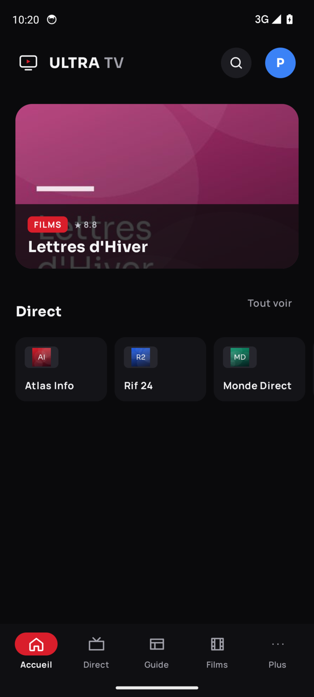
  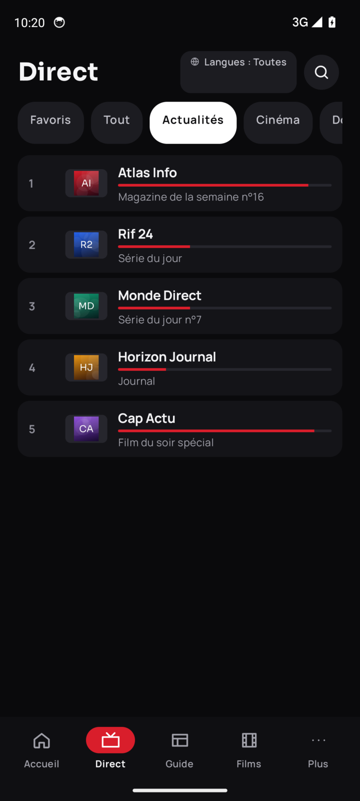
  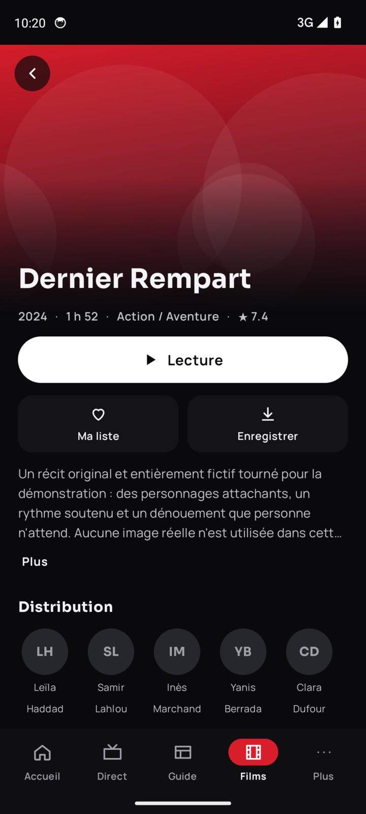
  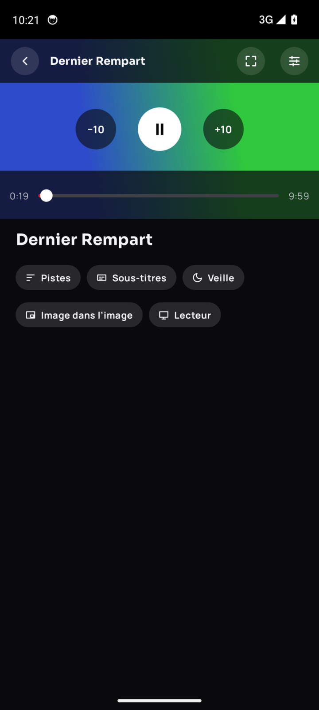
</p>

### Tablette Android

Menu latéral, liste et fiche côte à côte.

<p align="center">
  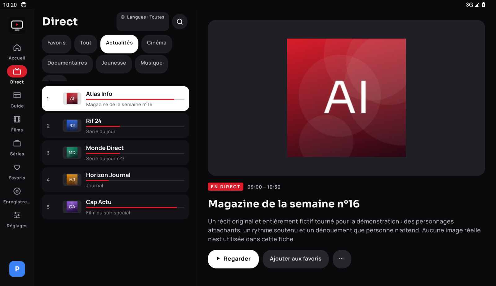
  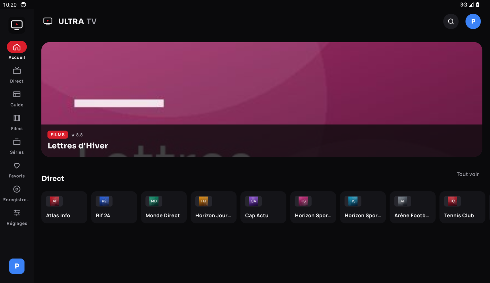
</p>

### Windows et macOS

Le même design sur ordinateur : l'application web de [`web/`](web/README.md) empaquetée par Electron ([`electron/`](electron/README.md)), utilisable aussi dans un navigateur. Xtream Codes et M3U (lien ou fichier) ; catalogue gardé en local (IndexedDB), identifiants chiffrés avec le trousseau du système, lecture directe (aucun proxy distant), mise à jour automatique via les Releases GitHub. **Recherche** : bouton rond sous le logo, raccourci `Ctrl/Cmd + K` ou `/` depuis n'importe quel écran.

<p align="center">
  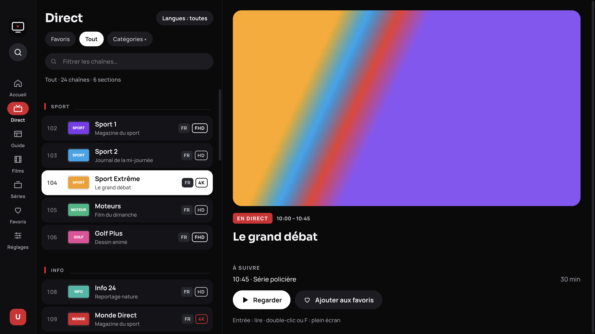
  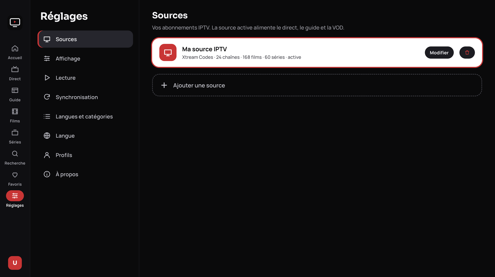
</p>

Toutes les captures du bureau (données synthétiques, FR et EN) : [`docs/screenshots/desktop/`](docs/screenshots/desktop/). Publication : tag `desktop-vX.Y.Z` (workflow `desktop-release.yml`, séparé des tags Android `v*`).

### Tableau de bord cloud

Gérez appareils et sources depuis un navigateur : **<https://ultratv-config.khalilbenaz.workers.dev>**.

<p align="center">
  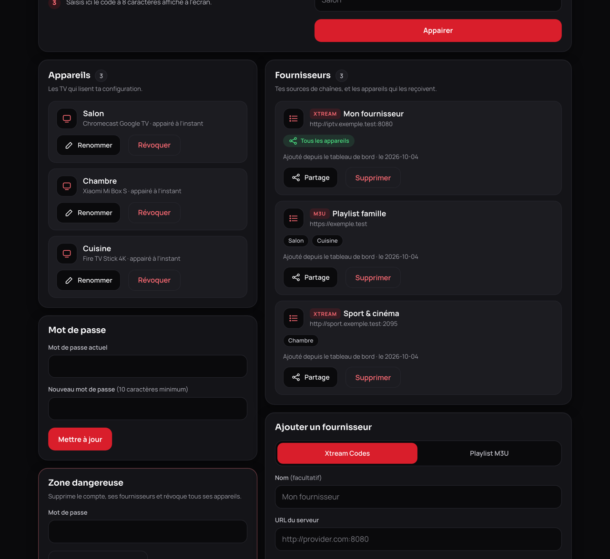
  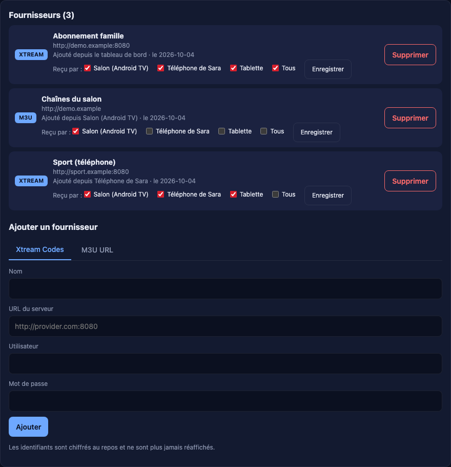
</p>

Sources **Xtream**, **M3U** et **portails Stalker** (adresse MAC masquée). Chaque appareil affiche son modèle, son édition, sa **version de l'appli** et sa dernière activité. Chaque source Xtream ou M3U a un bouton **Afficher le lien IPTV** (lien M3U complet, à la demande, avec bouton Copier) et son **abonnement** (statut, date d'expiration, jours restants, connexions), lu chez le fournisseur ; listes paginées avec recherche quand elles s'allongent.

Rubrique **Compte** :
- **Trakt** : bouton *Connecter Trakt*, autorisation chez Trakt ; vos appareils y envoient ensuite ce que vous regardez. Le mot de passe Trakt ne passe jamais par le site.
- **Sous-titres · OpenSubtitles** (facultatif) : reliez votre compte OpenSubtitles, gratuit ou VIP, pour utiliser votre propre quota de téléchargements au lieu du quota commun.

Appairage en un scan : la TV affiche un QR, l'appareil photo du téléphone ouvre la page d'appairage avec le code déjà rempli. Le code se saisit aussi à la main, avec ou sans tiret.

<p align="center">
  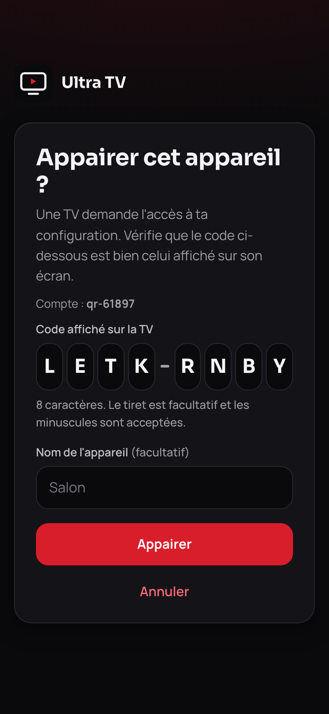
  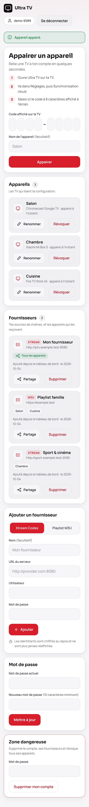
</p>

### Synchronisation multi-appareils

- **Même fournisseur partout** : un fournisseur ajouté dans le tableau de bord est reçu par tous les appareils du compte.
- **Source propre à un appareil** : une source ajoutée sur un appareil lui reste privée tant que vous ne la partagez pas.
- **Partage choisi par appareil** : source par source, vous cochez les appareils destinataires (dans l'application : Réglages › Sources › *Partager cette source* ; ou dans le tableau de bord).
- **Catégories partagées** : activer, désactiver une catégorie sur un appareil s'applique aux autres (la modification la plus récente gagne).
- **Favoris, reprises et derniers vus partagés** : un film commencé sur la TV reprend au même endroit sur le Mac ; un favori ajouté ou retiré l'est partout. Par source du compte, profils rapprochés par leur nom.
- Les modifications d'un compte sont sérialisées côté Worker (verrou Durable Object) : deux appareils qui écrivent en même temps ne s'écrasent pas.

## Téléchargements

| Appareil | Fichier |
|---|---|
| Android (TV, smartphone, tablette) | [`UltraTV-debug.apk`](https://github.com/vantaflow/ultra-tv/releases/latest/download/UltraTV-debug.apk) universel, ou un APK par processeur `UltraTV-<version>-<abi>.apk` (`arm64-v8a`, `armeabi-v7a`, `x86_64`) avec son profil précompilé `.dm`, plus `SHA256SUMS.txt` |
| macOS | `UltraTV-<version>-mac-universal.dmg` (Apple Silicon et Intel) |
| Windows | `UltraTV-<version>-win-x64.exe` (installeur NSIS) |
| Tableau de bord cloud | <https://ultratv-config.khalilbenaz.workers.dev> (aucune installation) |

Tout est sur la page [Releases](https://github.com/vantaflow/ultra-tv/releases) (les fichiers bureau portent les tags `desktop-v…`).

## Installation

Android 9 ou plus récent (API 28).

**APK.** Téléchargez [`UltraTV-debug.apk`](https://github.com/vantaflow/ultra-tv/releases/latest/download/UltraTV-debug.apk) (somme SHA-256 sur la page de la release) et installez-le.

**Downloader** (box sans navigateur) : ouvrez l'application [Downloader](https://www.aftvnews.com/downloader/), saisissez le code **`5248504`**, autorisez les sources inconnues, installez.

**adb** :

```bash
adb connect IP_DE_LA_BOX:5555
adb install -r UltraTV-debug.apk
```

**adb, démarrage plus rapide** (Android 12 ou plus récent) : installez l'APK de votre processeur avec son profil précompilé `.dm` (même nom, publié dans la release). Android compile alors l'application dès l'installation au lieu d'attendre une optimisation en tâche de fond. Mesuré sur une box 2 Go : démarrage 1,1 s → 0,6 s, défilement nettement plus fluide.

```bash
adb install-multiple -r UltraTV-<version>-armeabi-v7a.apk UltraTV-<version>-armeabi-v7a.dm
```

Au premier lancement : choisissez le type de source (Xtream Codes, lien M3U, fichier M3U, **portail Stalker** ou **Depuis le cloud**), saisissez-la, puis choisissez vos catégories (seules les catégories actives sont téléchargées).

Une adresse du type `…/get.php?username=…&password=…` collée comme lien M3U est reconnue et ajoutée comme source Xtream Codes (beaucoup de fournisseurs bloquent `get.php`).

## Synchronisation cloud

Pour ne pas saisir d'identifiants à la télécommande, gérez vos sources depuis un navigateur : **<https://ultratv-config.khalilbenaz.workers.dev>** (l'adresse est aussi affichée, avec un QR code, dans l'application : Réglages › Sources).

1. Créez un compte sur le tableau de bord et ajoutez vos sources.
2. Dans le tableau de bord, choisissez **Appairer une TV**.
3. Sur la box : **Depuis le cloud** (écran Source de l'assistant) ou Réglages › Sources › *Synchroniser depuis le cloud*. Un code à 8 caractères s'affiche ; saisissez-le dans le tableau de bord.
4. La box importe la configuration puis synchronise.

L'appareil reçoit un jeton aléatoire de 256 bits (haché côté serveur, chiffré dans le Keystore, révocable). Vos identifiants sont **chiffrés côté serveur** (AES-256-GCM). L'étiquette affichée pour la box (« UTV-XXXXXX ») n'est qu'un nom, jamais une clé.

**Auto-hébergement.** Vous pouvez déployer votre propre Worker (voir [Worker Cloudflare](#worker-cloudflare)) : créez les espaces KV, définissez les secrets `SESSION_SECRET`, `PROVIDER_ENC_KEY` et `OPS_TOKEN` (aucune valeur n'est publiée), puis `wrangler deploy` ; dans l'application, Réglages › Sources › *Adresse du tableau de bord* pointe alors vers le vôtre.

## Sécurité

- Identifiants des sources **chiffrés au repos** sur l'appareil ; sur le Worker, AES-256-GCM.
- **Aucune URL de flux, aucun identifiant n'est affiché** ni journalisé ; les messages d'erreur sont filtrés (`UserText`). Un nom de source vide ne reprend pas l'adresse du serveur.
- Aucun jeton partagé dans l'APK. Détails, modèle de menace et rotation des anciens secrets : [SECURITY.md](SECURITY.md).

## Réglages automatiques

À la première ouverture, l'**`AdaptiveProfile`** mesure l'appareil (mémoire, tas, micro-benchmark) et le classe **Bas / Moyen / Haut**. Il en déduit tampon, parallélisme et taille des lots de synchro, plafond de résolution et de débit (box à peu de mémoire : 720p / 6 Mb/s) et ajuste le tampon si des coupures surviennent. Tout reste modifiable : Réglages › Lecture (moteur, décodage, préréglage de tampon : Faible latence, Auto, Équilibré, Stable, Personnalisé).

## Développement

JDK 17 requis.

```bash
git clone https://github.com/vantaflow/ultra-tv && cd ultra-tv/android-native
export JAVA_HOME=$(/usr/libexec/java_home -v 17)   # macOS
./gradlew assembleDebug                            # APK universel
./gradlew testDebugUnitTest                        # tests unitaires (JUnit, Robolectric)
./gradlew assembleRelease                          # APK par ABI (arm64-v8a, armeabi-v7a, x86_64)
```

- La version vient du fichier [`VERSION`](VERSION) ; `versionCode = major×10000 + minor×100 + patch` (1.2.0 → 10200).
- **Faux serveur Xtream** pour tester sans abonnement : `python3 android-native/tools/fake-xtream/server.py` (l'émulateur y accède via `http://10.0.2.2:8099`, identifiants `test` / `test`).
- Build debug : intents de débogage (`debug_route`, `debug_theme`, `debug_engine`, `debug_decoder`, `debug_buffer`…) pour les captures et les mesures.
- **CI** ([ci.yml](.github/workflows/ci.yml)) : web (tsc + vitest), Android (compilation + tests unitaires), Worker. Publication : [release.yml](.github/workflows/release.yml) sur tag `v*` (APK universel `UltraTV-debug.apk`, APK par processeur `UltraTV-<version>-<abi>.apk` et `SHA256SUMS.txt`) ; site : [pages.yml](.github/workflows/pages.yml).

## Worker Cloudflare

`cloudflare-config/` : tableau de bord d'appairage, stockage chiffré des sources, ingestion des crashs, proxies TMDB et OpenSubtitles. Procédure complète : [cloudflare-config/README.md](cloudflare-config/README.md).

```bash
cd cloudflare-config && npm ci
wrangler kv namespace create CONFIG                # coller les ids dans wrangler.toml
wrangler secret put SESSION_SECRET                 # >= 32 caractères aléatoires
wrangler secret put PROVIDER_ENC_KEY               # clé AES-256 en base64
wrangler secret put OPS_TOKEN                      # mot de passe de /crashes et /logs
wrangler secret put TMDB_READ_TOKEN                # jeton de lecture TMDB v4 (fiches enrichies)
wrangler secret put TMDB_API_KEY                   # clé TMDB v3 (repli si pas de jeton v4)
wrangler secret put OPENSUBTITLES_API_KEY          # clé OpenSubtitles (sous-titres en ligne)
wrangler secret put ACCOUNT_RELAY_KEY              # facultatif : relais d'abonnement hors Cloudflare (cloudflare-config/relay)
npm test && wrangler deploy --dry-run
```

TMDB et OpenSubtitles sont facultatifs : sans leurs secrets, l'application masque les fonctions correspondantes. Trakt utilise `TRAKT_CLIENT_ID` (`wrangler.toml`, application Trakt en PKCE : pas de secret client). Pour un fork, compilez avec `-PULTRA_WORKER_URL=https://votre-worker.workers.dev`.

## Limites connues

- Le **replay** et la **pause du direct** dépendent de la source (catch-up Xtream, flux MPEG-TS) ; indisponibles sinon.
- Les fiches TMDB et les sous-titres en ligne exigent un Worker configuré avec les secrets ci-dessus.
- Un épisode commencé sur la TV apparaît dans « Reprendre » sur l'ordinateur une fois la série ouverte au moins une fois sur celui-ci.
- Aucun guide gratuit ne couvre les chaînes marocaines (2M, Al Aoula…) : seul le guide du fournisseur les renseigne.
- La première synchro d'un très gros catalogue (≈ 55 000 chaînes) prend environ une minute sur un appareil de milieu de gamme et davantage sur un modèle d'entrée de gamme.
- L'APK grossit avec LibVLC (≈ 53 Mo en arm64-v8a, contre ≈ 9 Mo en 1.0.x).
- Les mesures publiées dans les notes de version viennent d'émulateurs Android TV (rendu logiciel) : à confirmer sur matériel réel.

## Licence

MIT, voir [LICENSE](LICENSE). Ultra TV est un client IPTV : utilisez uniquement des listes, guides et identifiants que vous avez le droit d'utiliser. Les polices Sora et Manrope sont sous licence OFL.
