<p align="center">
  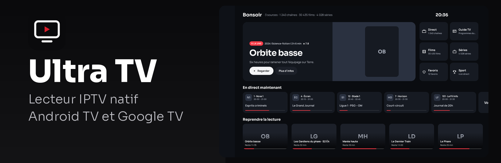
</p>

<h1 align="center">Ultra TV</h1>

<p align="center">
  <strong>Lecteur IPTV gratuit et open source pour Android TV, téléphone, tablette, Windows et Mac — sans pub, sans compte, pensé pour la télécommande.</strong>
</p>

<p align="center">
  <a href="https://github.com/vantaflow/ultra-tv/actions/workflows/ci.yml"></a>
  <a href="https://github.com/vantaflow/ultra-tv/releases/latest"></a>
  <a href="LICENSE"></a>
  <a href="https://vantaflow.github.io/ultra-tv/"></a>
</p>

<p align="center">
  <a href="README.en.md">🇬🇧 English version</a> ·
  <a href="https://vantaflow.github.io/ultra-tv/">Site</a> ·
  <a href="https://tv.weedy.dpdns.org/download/android">Télécharger l'APK</a> ·
  <a href="https://github.com/vantaflow/ultra-tv/releases">Releases</a> ·
  <a href="CHANGELOG.md">Changelog</a>
</p>

---

## Télécharger

| Appareil | Lien |
|---|---|
| **Android TV, Google TV, box, Fire TV**, téléphone et tablette Android (Android 9+) | Voir « Quel APK prendre ? » ci-dessous · sur une box : appli Downloader, code **`5189921`** |
| **Windows** (x64) | [Installeur .exe](https://tv.weedy.dpdns.org/download/windows) |
| **Mac** (Apple Silicon et Intel) | [Image disque .dmg](https://tv.weedy.dpdns.org/download/mac) |
| **Linux** (x86_64) | [AppImage](https://tv.weedy.dpdns.org/download/linux) · [.deb](https://tv.weedy.dpdns.org/download/linux-deb) (Debian, Ubuntu) · [.rpm](https://tv.weedy.dpdns.org/download/linux-rpm) (Fedora, openSUSE) · Ubuntu 22.04+ : `sudo apt install libfuse2` si l'AppImage ne démarre pas |

Mises à jour automatiques ensuite, sur toutes les plateformes. Aucun compte n'est nécessaire.


Ultra TV lit vos propres abonnements IPTV (**Xtream Codes**, **M3U / M3U8** en lien ou en fichier, **portails Stalker / Ministra** par adresse MAC). Toute l'interface est native et pilotée à la télécommande ; le catalogue (chaînes, films, séries, guide, historique, favoris) vit dans une base Room locale. Il ne fournit **aucun contenu**.

> Captures de la nouvelle interface (1.2.98), rendues avec un **catalogue entièrement fictif** : chaînes, catégories, programmes et titres inventés. Ultra TV ne fournit aucun contenu.

<p align="center">
  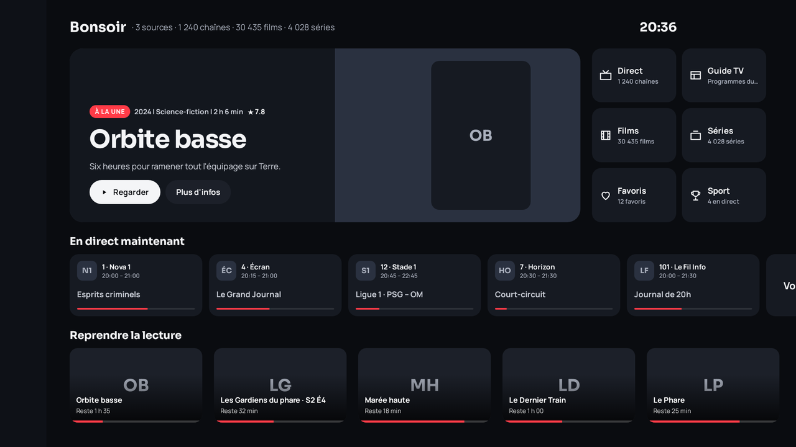
  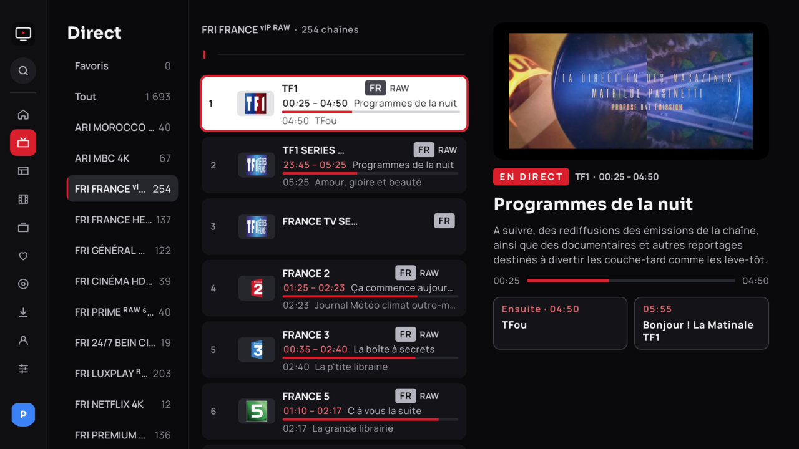
  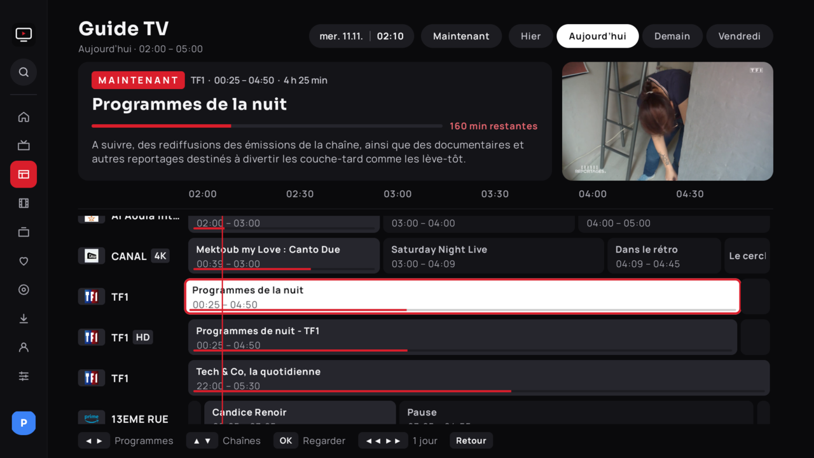
  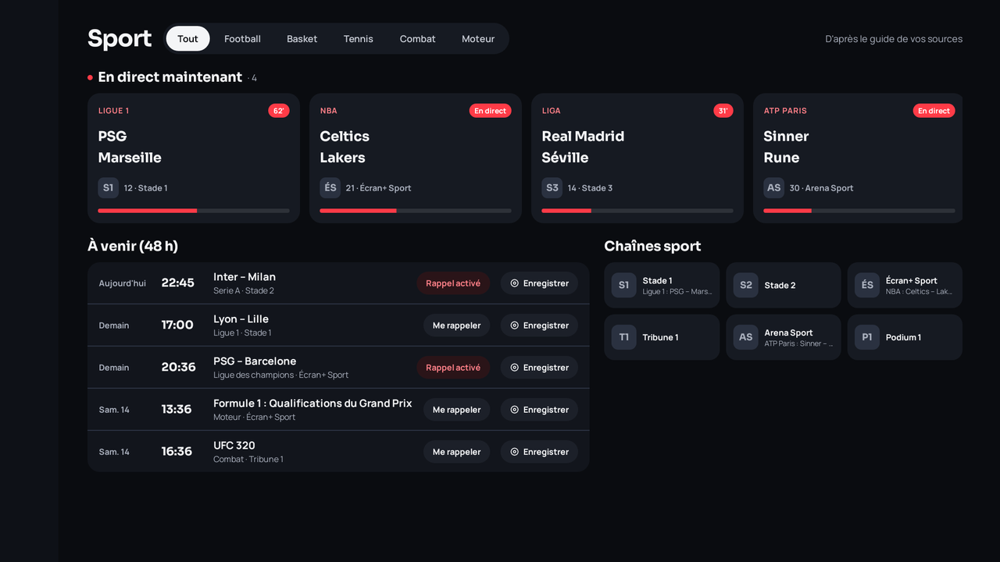
  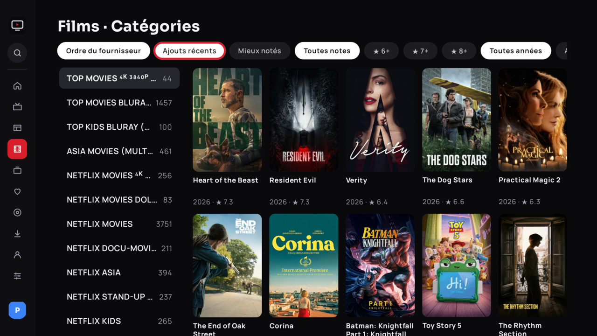
  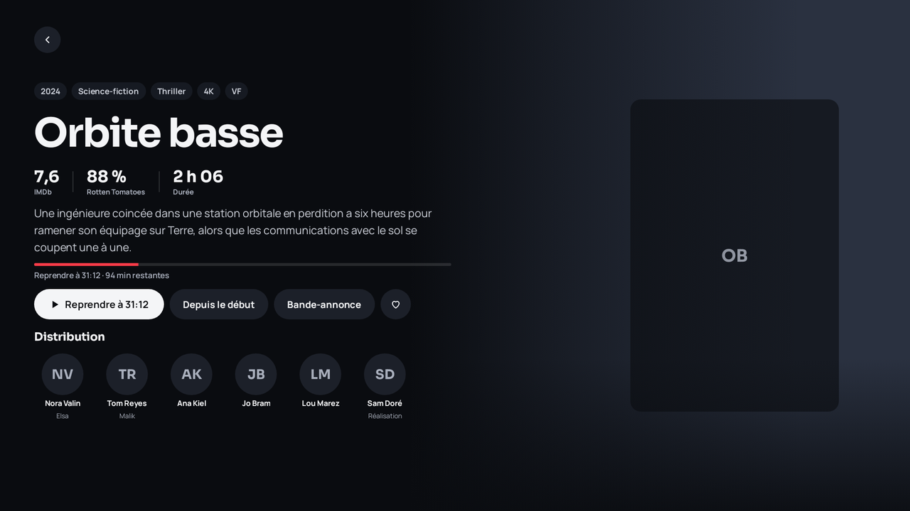
  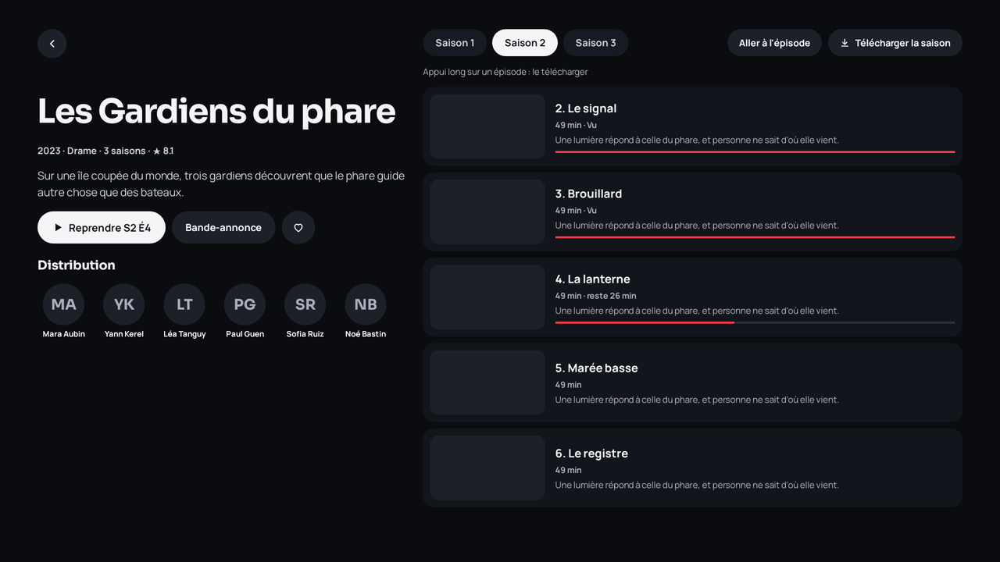
  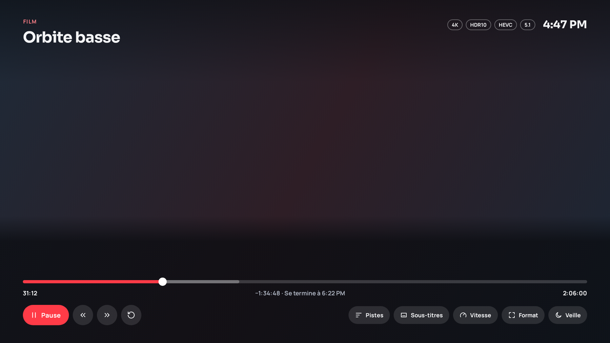
  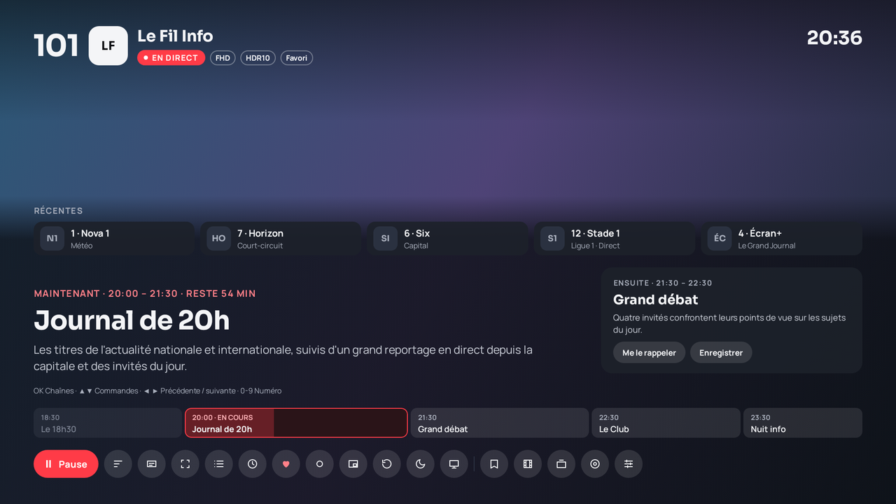
  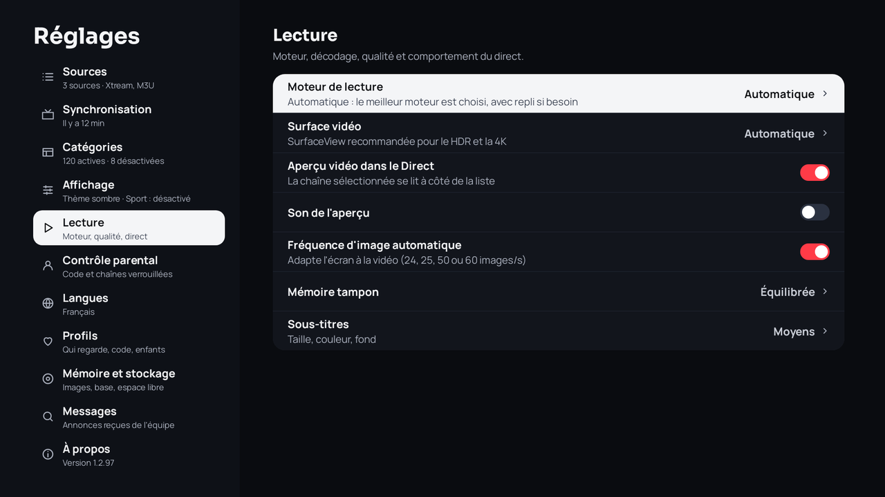
  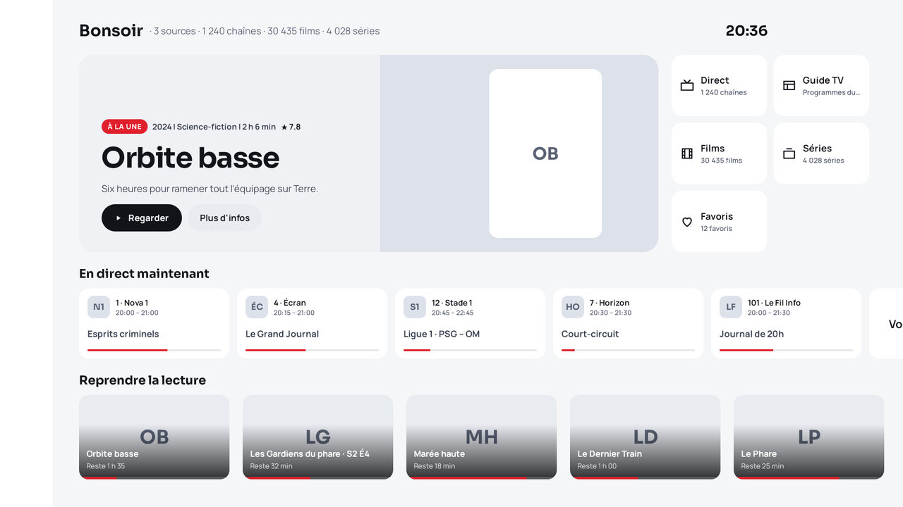
  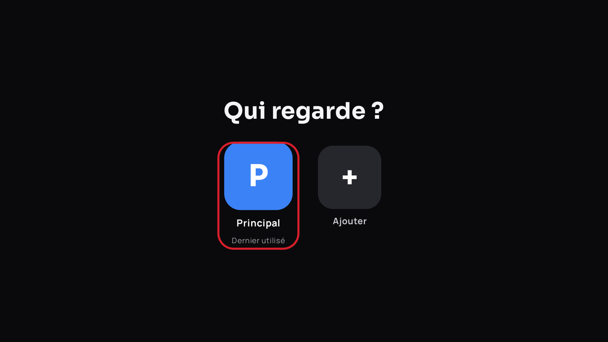
</p>

Captures aussi disponibles en anglais ([`docs/screenshots/en`](docs/screenshots/en)) et en arabe, interface en miroir ([`docs/screenshots/ar`](docs/screenshots/ar)).

## Fonctionnalités

- **Nouvelle interface (1.2.98)** sur TV, téléphone, tablette et bureau : thèmes sombre et clair redessinés, accueil avec « À la une » et raccourcis, surcouche du Direct (chaînes récentes, programme en cours, « Ensuite », ruban de la soirée), liste des chaînes en feuille latérale, guide filtrable par catégorie, fiches et lecteurs films / séries refaits, courte animation d'ouverture.
- **Sport** (rubrique facultative, Réglages › Affichage, sur TV et bureau) : matchs en direct et à venir sur 48 h d'après le guide de vos sources, par discipline, avec rappels, enregistrements et **écussons des équipes** ([TheSportsDB](https://www.thesportsdb.com)).
- **Recherche** depuis n'importe quel écran : bouton en haut du menu latéral, touches Recherche et micro de la télécommande.
- **Direct** : **aperçu vidéo** de la chaîne sélectionnée dans la liste (avec le son, délai réglable), **OK la passe en plein écran sans recharger le flux** ; Haut/Bas zappent, **OK ouvre la liste des chaînes**, touches chaîne +/− et TV des télécommandes Google TV ; bandeau chaîne et programme ; zapping par numéro, Retour revient au menu (touche « chaîne précédente » pour la dernière chaîne), 20 chaînes récentes, recherche instantanée (FTS).
- **Catégories** : noms et ordre de la playlist tels que fournis par la source, activer / désactiver / réordonner, filtre texte (« FR » = mot entier) ; pastilles de qualité (SD, HD, FHD, 4K, RAW, HEVC…) pour distinguer les flux d'une même chaîne.
- **Guide** : grille horaire, rappels, enregistrements programmés, **replay** (catch-up Xtream) depuis le guide quand la source le permet. Programme repris d'une chaîne du même nom quand le fournisseur n'en donne qu'à une catégorie (HEVC, Général…), chaînes « +1 / +2 » décalées d'autant, programme court du fournisseur en secours, et **guide complémentaire gratuit** (XMLTV France par défaut, epgshare01 beIN Sports / Arabie saoudite / Émirats) pour les chaînes restées sans programme.
- **Pause du direct** (timeshift) : tampon disque circulaire pour les flux MPEG-TS.
- **Films et séries** : fiches enrichies via **TMDB** (affiche, synopsis, distribution, bande-annonce, en anglais si aucune n'existe dans votre langue), **logo officiel du titre et fond HD** via [Fanart.tv](https://fanart.tv), **prochain épisode** d'une série (date, titre) via [TVmaze](https://www.tvmaze.com), **reprise automatique** (position enregistrée toutes les 30 s), saisons en onglets, rangées par catégorie.
- **Passer l'intro** : boutons « Passer l'intro », « Passer le résumé » et « Épisode suivant » pendant les génériques, d'après [TheIntroDB](https://theintrodb.org) (base communautaire, sans clé).
- **Notes IMDb / Rotten Tomatoes** sur les fiches (OMDb via le Worker), **pages acteurs et réalisateurs** (leurs titres présents dans la playlist).
- **Accueil** : « À la une » qui défile, rangée **« Nouveaux épisodes »** (séries favorites ou en cours dont un épisode est sorti ou sort dans les 7 jours), rangées « Parce que vous avez regardé… », « Films / Séries les mieux notés » ; **filtres** Films / Séries (tri, note minimale, période) ; **recherche tolérante aux fautes**.
- **Guide personnalisé** : une **adresse de guide XMLTV** (`http://` ou `https://`, finissant par `.xml` ou `.xml.gz`, query string tolérée). Deux usages. (1) **Guide complémentaire** : Réglages › Synchronisation › Guide complémentaire › *Adresse personnalisée…* (lu seulement pour les chaînes restées sans programme). (2) **Guide de cette source** : Réglages › Sources › (menu de la source) › *Guide de cette source*, avec le mode **remplacer** (seule cette adresse est lue) ou **compléter** (guide du fournisseur d'abord, puis cette adresse pour les chaînes sans programme) ; utile pour une playlist M3U sans `url-tvg` et pour un portail Stalker, qui n'a pas de guide XMLTV propre (chaînes rattachées par `epgChannelId`, sinon par nom). L'adresse est **vérifiée avant l'enregistrement** (requête réseau, gzip détecté, balise `<tv` obligatoire ; message clair si injoignable, code HTTP ou pas un guide XMLTV). Saisie à la télécommande, depuis le téléphone (page `/envoyer`, type *Guide XMLTV*, pour le guide complémentaire) ou sur le bureau (Réglages › Synchronisation, et *Options avancées* d'une source).
- **Envoi depuis le téléphone, sans compte** : la TV affiche un QR code et un code ; la playlist (Xtream, M3U ou Stalker) se saisit sur le téléphone ou l'ordinateur (page `/envoyer` du Worker), puis la TV l'ajoute et la synchronise. Plus besoin de tout taper à la télécommande.
- **Télécommande et recherche sur le téléphone** (Réglages › Sources) : la box sert une page sur le réseau local (QR code) pour chercher un film, une série ou une chaîne et piloter la lecture ; désactivée par défaut, protégée par une clé.
- **Mode simple** : six grandes tuiles (Télé en direct, Reprendre, Films, Séries, Favoris, Rechercher), réglable par profil.
- **Mémoire et stockage** : espace utilisé détaillé, mémoire vive, nettoyage du cache et de la base, mode économie de mémoire pour les box modestes, **Optimiser les images** (logos et fonds Fanart.tv / TVmaze servis en WebP à la bonne taille par wsrv.nl ; désactivable).
- **Catégories masquées jamais chargées** : une catégorie désactivée (par sa langue ou à la main, séparément pour le Direct, les Films et les Séries) n'est ni téléchargée en base ni indexée : synchro plus rapide, moins de mémoire.
- **Films et Séries par genres automatiques** : liste des catégories ou des genres détectés (Action, Comédie, Anime…) avec leur nombre de titres, grille d'affiches, tri et filtres.
- **Téléchargements** (Android) : films, épisodes ou saison entière ; file d'attente avec pause, reprise, annulation et nouvel essai, reprise après coupure, Wi-Fi seulement en option ; écran « Téléchargements » utilisable hors ligne.
- **Deux moteurs de lecture** : ExoPlayer (Media3) et **LibVLC**, choix Auto / ExoPlayer / VLC, décodage Auto / Matériel / Logiciel, repli automatique et mémorisation par chaîne.
- **Sous-titres** : recherche en ligne (OpenSubtitles via le Worker), style avancé (taille, couleur, fond, contour, position, décalage). Rien à configurer sur l'appareil ; un compte OpenSubtitles personnel se relie, au besoin, depuis le tableau de bord cloud.
- **Trakt** : films et épisodes regardés envoyés à Trakt (en cours, puis vu à la fin) ; à l'accueil, **watchlist**, **recommandations**, **tendances**, **populaires**, **listes personnelles** et **« À suivre »**, limitées aux titres disponibles dans la playlist chargée ; marque **« Vu »** ; depuis les fiches : ajouter / retirer de la watchlist, marquer vu / non vu (film, épisode, saison), **noter de 1 à 10** ; positions de reprise importées. Connexion depuis le tableau de bord cloud, rien à régler sur la TV.
- **Profils** : « Qui regarde ? », profil Enfants, favoris, historique et langues par profil.
- **Abonnement** (menu) : état de votre abonnement IPTV tel que l'indique le fournisseur — statut, date d'expiration et jours restants, connexions utilisées / autorisées, compte d'essai, serveur. Android, Windows et macOS.
- **Google TV, Android TV et lanceurs tiers** : « Continuer à regarder » (films, épisodes et dernières chaînes du direct, titres nettoyés, un seul exemplaire par film), chaîne d'accueil **Favoris** (favoris puis dernières chaînes) et chaîne **Nouveautés** (derniers films et séries ajoutés, sans doublon), recherche vocale et globale, liens profonds `ultratv://`. Ces rangées passent par le fournisseur TV d'Android : les lanceurs qui le lisent (Kairo…) les affichent aussi.
- **Lecture** : pas de mise en veille pendant un film ou le direct, pause en quittant l'application (plus de son en arrière-plan) ; horloge sans décalage et fuseau horaire réglable (Réglages › Affichage).
- **Thèmes** Sombre / Clair / **Noir (OLED)** / Automatique (le lecteur reste toujours sombre) ; interface en anglais, français, espagnol et arabe (RTL), plus le polonais et le portugais du Brésil (premiers jets communautaires).
- **Personnalisation** (Réglages › Affichage) : **couleur d'accent** (12 choix), **taille du texte**, **format de l'heure** (Automatique, 12 h ou 24 h), **rangées de l'accueil** (afficher, masquer, réordonner), **écran d'ouverture** (Accueil, Direct, Films, Séries, Guide ou dernière chaîne).
- **DNS personnalisé** (Android et bureau) : Google, Cloudflare, Quad9, DNS-over-HTTPS ou serveur au choix ; appliqué au catalogue, au guide, aux images et aux flux (sur Android : flux ExoPlayer, pas VLC ; bouton Tester), repli automatique sur le DNS du système.
- **Veille** : minuterie 30 / 60 / 90 min ou fin de programme ; mise à jour intégrée depuis les releases GitHub.

## Appareils

Un seul compte, tous vos écrans : même interface, même fournisseur partout. Ajoutez-le une fois dans le [tableau de bord cloud](#synchronisation-cloud) et chaque appareil le reçoit.

### Android TV et Google TV

L'application d'origine, pilotée à la télécommande (voir les captures ci-dessus et [Fonctionnalités](#fonctionnalités)).

### Smartphone Android

Interface tactile : barre de navigation en bas, listes et grilles au doigt, lecteur à gestes avec image dans l'image ; les formulaires se calent au-dessus du clavier.

<p align="center">
  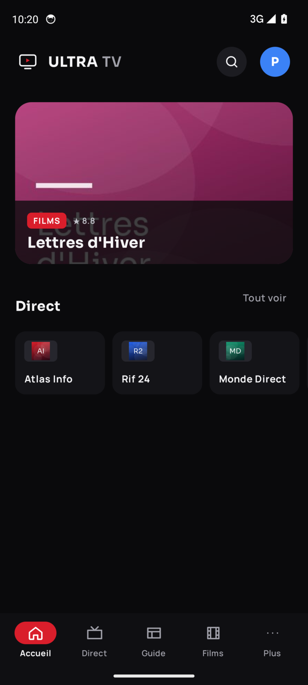
  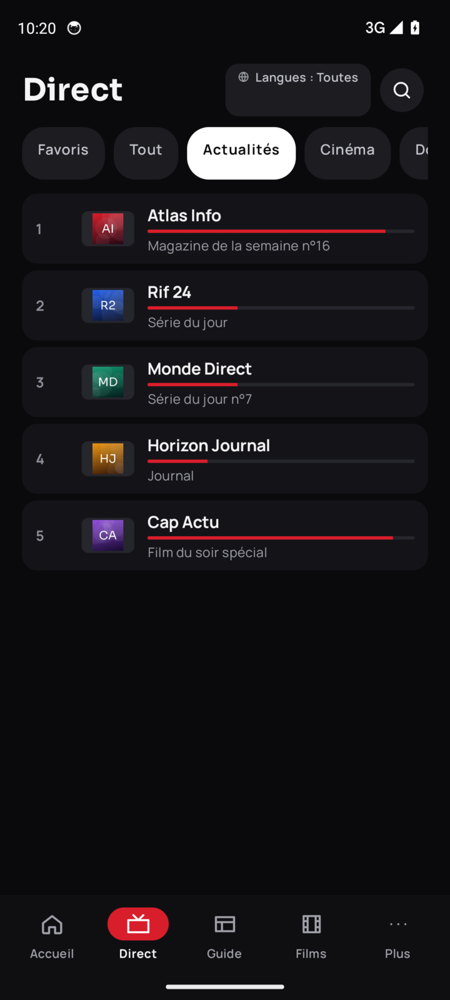
  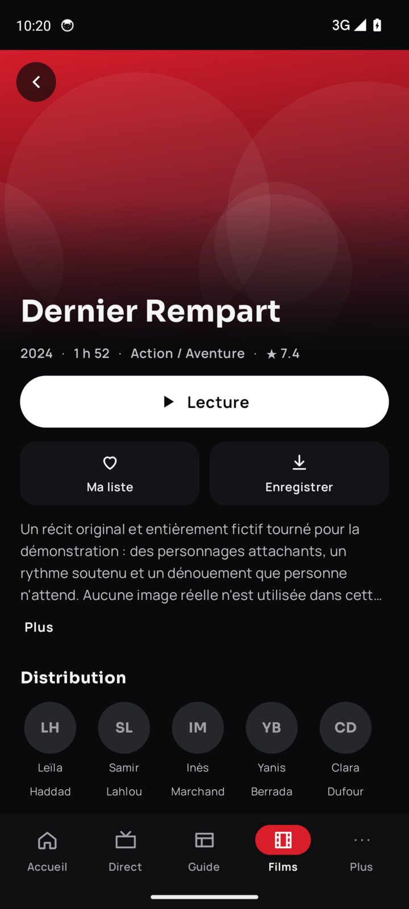
  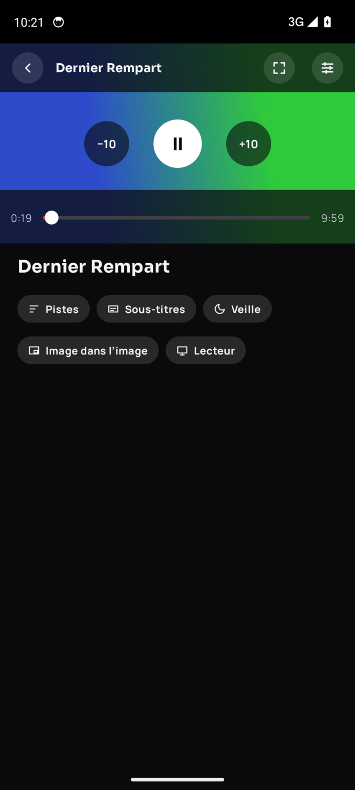
</p>

### Tablette Android

Menu latéral, liste et fiche côte à côte.

<p align="center">
  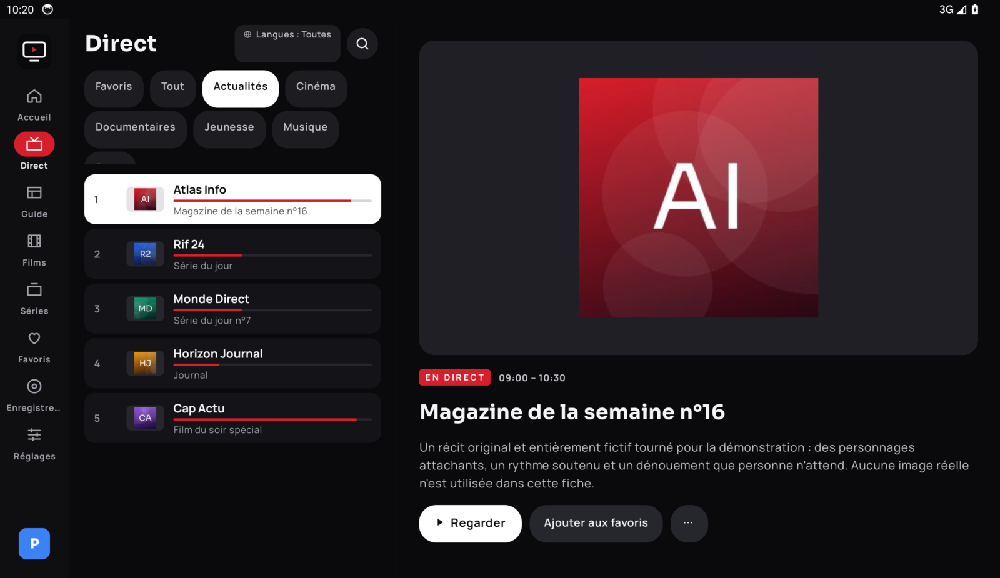
  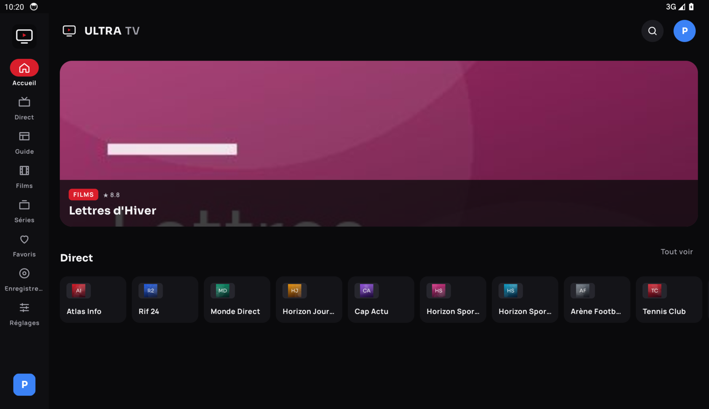
</p>

### Windows et macOS

Le même design sur ordinateur : l'application web de [`web/`](web/README.md) empaquetée par Electron ([`electron/`](electron/README.md)). Sur le web, seul le tableau de bord de gestion est proposé (pas de lecteur). Xtream Codes et M3U (lien ou fichier) ; catalogue gardé en local (IndexedDB), identifiants chiffrés avec le trousseau du système, lecture directe (aucun proxy distant), mise à jour automatique via les Releases GitHub. **Recherche** : bouton rond sous le logo, raccourci `Ctrl/Cmd + K` ou `/` depuis n'importe quel écran. **Sport, rappels et enregistrements** : rubrique Sport, « Me rappeler » (notification système) et « Enregistrer » (fichier .ts dans Vidéos/Ultra TV, l'application doit rester ouverte) depuis le guide et Sport, écran « Enregistrés » ; bouton **Épisodes** dans le lecteur des séries (touche E). **Son AC-3 / DTS** : converti automatiquement en AAC par ffmpeg (embarqué sous Windows ; sur macOS, installez-le avec `brew install ffmpeg`).

<p align="center">
  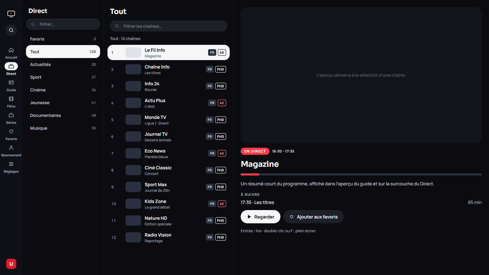
  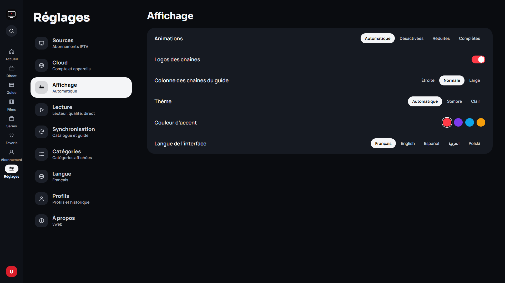
</p>

Toutes les captures du bureau (données synthétiques, FR et EN) : [`docs/screenshots/desktop/`](docs/screenshots/desktop/). Publication : tag `desktop-vX.Y.Z` (workflow `desktop-release.yml`, séparé des tags Android `v*`).

### Tableau de bord cloud

Gérez appareils et sources depuis un navigateur : **<https://tv.weedy.dpdns.org>** (l'ancienne adresse `ultratv-config.khalilbenaz.workers.dev` reste active ; les applis basculent d'elle-même si l'une est bloquée sur votre réseau).

<p align="center">
  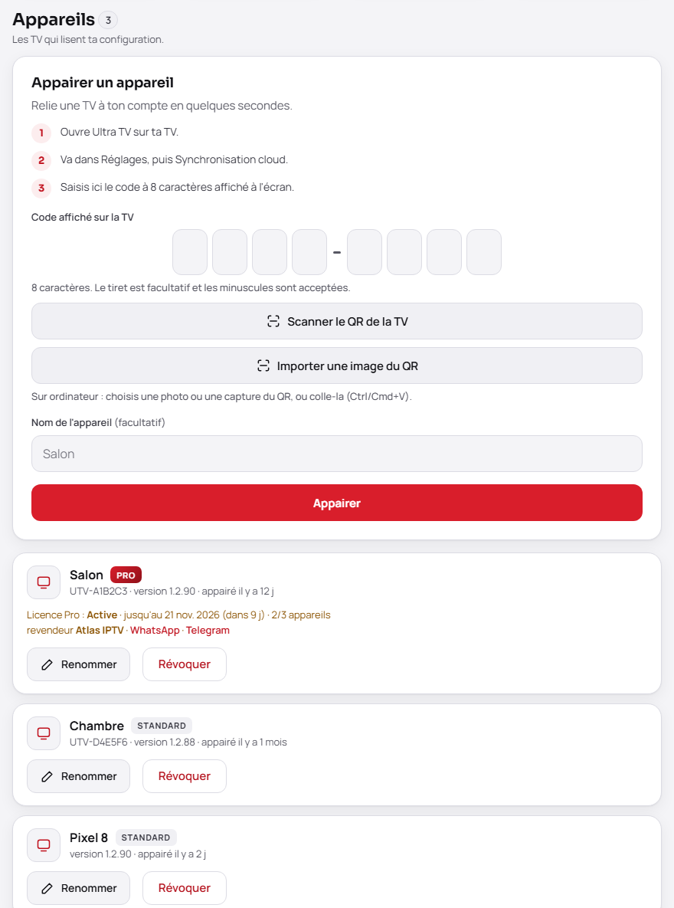
  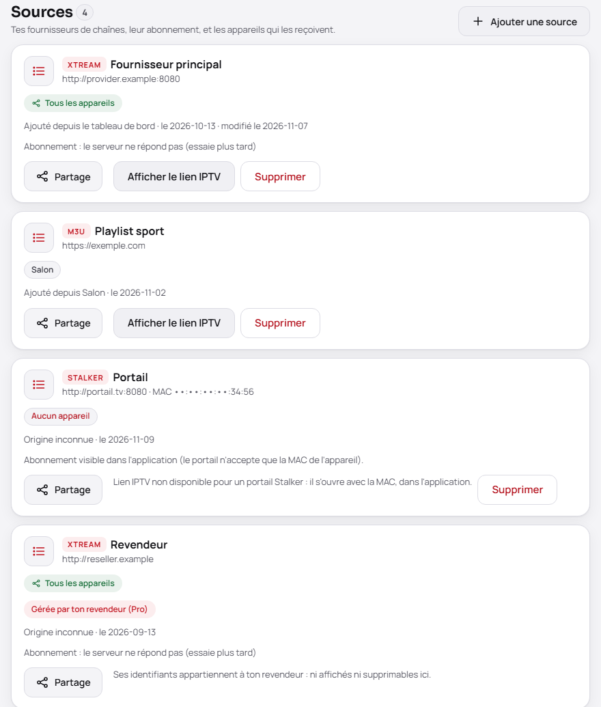
</p>

Sources **Xtream**, **M3U** et **portails Stalker** (adresse MAC masquée). Chaque appareil affiche son modèle, son édition, sa **version de l'appli** et sa dernière activité. Chaque source Xtream ou M3U a un bouton **Afficher le lien IPTV** (lien M3U complet, à la demande, avec bouton Copier) et son **abonnement** (statut, date d'expiration, jours restants, connexions), lu chez le fournisseur ; listes paginées avec recherche quand elles s'allongent.

Rubrique **Administration** (comptes listés dans `ADMIN_LOGINS`) : statistiques, comptes et **alertes**. Une alerte est un message (titre, texte, niveau Information / Avertissement / Urgent) programmé avec une date de début et de fin, pour tous les appareils ou seulement les TV ou les téléphones, éventuellement réservé aux versions de l'application antérieures à une version donnée et accompagné d'un bouton « Mettre à jour ». Les applications le vérifient au lancement puis toutes les 15 minutes. « Information » s'affiche en bandeau discret, « Avertissement » et « Urgent » en fenêtre à valider ; pendant la lecture, seule une alerte « Urgent » s'affiche (en bandeau). Le tableau de bord indique pour chaque alerte sur combien d'appareils elle a été affichée et fermée. Les alertes reçues restent lisibles dans Réglages › Messages.

Rubrique **Compte** :
- **Trakt** : bouton *Connecter Trakt*, autorisation chez Trakt ; vos appareils y envoient ensuite ce que vous regardez. Le mot de passe Trakt ne passe jamais par le site.
- **Sous-titres · OpenSubtitles** (facultatif) : reliez votre compte OpenSubtitles, gratuit ou VIP, pour utiliser votre propre quota de téléchargements au lieu du quota commun.

Appairage en un scan : la TV affiche un QR, l'appareil photo du téléphone ouvre la page d'appairage avec le code déjà rempli. Le code se saisit aussi à la main, avec ou sans tiret.

<p align="center">
  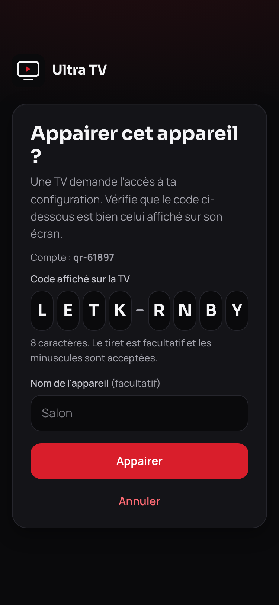
  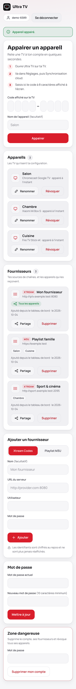
</p>

### Synchronisation multi-appareils

- **Même fournisseur partout** : un fournisseur ajouté dans le tableau de bord est reçu par tous les appareils du compte.
- **Source propre à un appareil** : une source ajoutée sur un appareil lui reste privée tant que vous ne la partagez pas.
- **Partage choisi par appareil** : source par source, vous cochez les appareils destinataires (dans l'application : Réglages › Sources › *Partager cette source* ; ou dans le tableau de bord).
- **Catégories partagées** : activer, désactiver une catégorie sur un appareil s'applique aux autres (la modification la plus récente gagne).
- **Favoris, reprises et derniers vus partagés** : un film commencé sur la TV reprend au même endroit sur le Mac ; un favori ajouté ou retiré l'est partout. Par source du compte, profils rapprochés par leur nom.
- Les modifications d'un compte sont sérialisées côté Worker (verrou Durable Object) : deux appareils qui écrivent en même temps ne s'écrasent pas.

## Téléchargements

| Appareil | Fichier |
|---|---|
| Android (TV, smartphone, tablette) | [`UltraTV-arm64-v8a.apk`](https://github.com/vantaflow/ultra-tv/releases/latest/download/UltraTV-arm64-v8a.apk) (par défaut), [`UltraTV-armeabi-v7a.apk`](https://github.com/vantaflow/ultra-tv/releases/latest/download/UltraTV-armeabi-v7a.apk) (32 bits), ou l'universel [`UltraTV.apk`](https://github.com/vantaflow/ultra-tv/releases/latest/download/UltraTV.apk) ; fichiers versionnés `UltraTV-<version>-<abi>.apk` avec leur profil précompilé `.dm`, plus `SHA256SUMS.txt` |
| macOS | `UltraTV-<version>-mac-universal.dmg` (Apple Silicon et Intel) |
| Windows | `UltraTV-<version>-win-x64.exe` (installeur NSIS) |
| Tableau de bord cloud | <https://tv.weedy.dpdns.org> (aucune installation) |

Tout est sur la page [Releases](https://github.com/vantaflow/ultra-tv/releases) (les fichiers bureau portent les tags `desktop-v…`).

## Installation

Android 9 ou plus récent (API 28).

**APK.** Téléchargez [`UltraTV-arm64-v8a.apk`](https://github.com/vantaflow/ultra-tv/releases/latest/download/UltraTV-arm64-v8a.apk) (somme SHA-256 sur la page de la release) et installez-le. Si l'installation échoue (appareil 32 bits comme le Chromecast avec Google TV HD), prenez [`UltraTV-armeabi-v7a.apk`](https://github.com/vantaflow/ultra-tv/releases/latest/download/UltraTV-armeabi-v7a.apk) ; en dernier recours, l'[APK universel](https://github.com/vantaflow/ultra-tv/releases/latest/download/UltraTV.apk).

**Downloader** (box sans navigateur) : ouvrez l'application [Downloader](https://www.aftvnews.com/downloader/), saisissez le code **`5189921`**, autorisez les sources inconnues, installez.

**adb** :

```bash
adb connect IP_DE_LA_BOX:5555
adb install -r UltraTV.apk
```

**adb, démarrage plus rapide** (Android 12 ou plus récent) : installez l'APK de votre processeur avec son profil précompilé `.dm` (même nom, publié dans la release). Android compile alors l'application dès l'installation au lieu d'attendre une optimisation en tâche de fond. Mesuré sur une box 2 Go : démarrage 1,1 s → 0,6 s, défilement nettement plus fluide.

```bash
adb install-multiple -r UltraTV-<version>-armeabi-v7a.apk UltraTV-<version>-armeabi-v7a.dm
```

Au premier lancement : choisissez le type de source (Xtream Codes, lien M3U, fichier M3U, **portail Stalker** ou **Depuis le cloud**), saisissez-la, puis choisissez vos catégories (seules les catégories actives sont téléchargées).

Une adresse du type `…/get.php?username=…&password=…` collée comme lien M3U est reconnue et ajoutée comme source Xtream Codes (beaucoup de fournisseurs bloquent `get.php`).

### Quel APK prendre ?

| Votre appareil | APK | Lien court (à taper dans Downloader) |
|---|---|---|
| Fire TV Stick récent, Shield, la plupart des box et téléphones récents (64 bits) | **arm64** (≈ 67 Mo), recommandé | [`tv.weedy.dpdns.org/download/android-arm64`](https://tv.weedy.dpdns.org/download/android-arm64) |
| **Chromecast avec Google TV (HD)**, vieilles box (32 bits) | **32 bits (armv7)** (≈ 52 Mo) | [`tv.weedy.dpdns.org/download/android-32`](https://tv.weedy.dpdns.org/download/android-32) |
| Vous ne savez pas | Universel (≈ 227 Mo), dernier recours | [`tv.weedy.dpdns.org/download/android-universal`](https://tv.weedy.dpdns.org/download/android-universal) |

`tv.weedy.dpdns.org/apk` affiche le choix 64 bits / 32 bits / universel (pratique dans Downloader) ; `…/download/android` renvoie directement l'APK arm64. Dans Downloader, saisissez le code **`5189921`** ou l'un des liens courts ci-dessus. Si l'installation échoue, prenez la version 32 bits.

### Installation impossible (« problème de package »)

- **Espace libre** : prévoyez au moins 500 Mo ; l'APK universel (227 Mo) en demande davantage que les APK par processeur.
- **Mauvais APK** : sur un appareil 32 bits (Chromecast avec Google TV HD), prenez l'APK 32 bits (`android-32`) plutôt que l'universel.
- **Ancienne version signée autrement** : désinstallez d'abord l'ancienne Ultra TV (Réglages › Applications), puis réinstallez. Vos sources restent dans le cloud si vous l'avez activé.
- **Téléchargement tronqué** : comparez la taille du fichier à celle de la release et sa somme SHA-256 au fichier `.sha256` (ou `SHA256SUMS.txt`) publié avec lui ; retéléchargez en cas de différence.
- **Android 9 minimum** : les versions plus anciennes ne sont pas prises en charge.

## Synchronisation cloud

Pour ne pas saisir d'identifiants à la télécommande, gérez vos sources depuis un navigateur : **<https://tv.weedy.dpdns.org>** (l'adresse est aussi affichée, avec un QR code, dans l'application : Réglages › Sources).

1. Créez un compte sur le tableau de bord et ajoutez vos sources.
2. Dans le tableau de bord, choisissez **Appairer une TV**.
3. Sur la box : **Depuis le cloud** (écran Source de l'assistant) ou Réglages › Sources › *Synchroniser depuis le cloud*. Un code à 8 caractères s'affiche ; saisissez-le dans le tableau de bord.
4. La box importe la configuration puis synchronise.

L'appareil reçoit un jeton aléatoire de 256 bits (haché côté serveur, chiffré dans le Keystore, révocable). **Appareil révoqué** depuis le tableau de bord (perdu, prêté, vendu) : dès sa vérification suivante (retour sur l'appli, au plus 10 min), il retire les sources reçues du cloud, oublie l'appairage et l'indique ; les sources ajoutées à la main sur l'appareil restent. Vos identifiants sont **chiffrés côté serveur** (AES-256-GCM). L'étiquette affichée pour la box (« UTV-XXXXXX ») n'est qu'un nom, jamais une clé.

**Auto-hébergement.** Vous pouvez déployer votre propre Worker (voir [Worker Cloudflare](#worker-cloudflare)) : créez les espaces KV, définissez les secrets `SESSION_SECRET`, `PROVIDER_ENC_KEY` et `OPS_TOKEN` (aucune valeur n'est publiée), puis `wrangler deploy` ; dans l'application, Réglages › Sources › *Adresse du tableau de bord* pointe alors vers le vôtre.

## Sécurité

- Identifiants des sources **chiffrés au repos** sur l'appareil ; sur le Worker, AES-256-GCM.
- **Aucune URL de flux, aucun identifiant n'est affiché** ni journalisé ; les messages d'erreur sont filtrés (`UserText`). Un nom de source vide ne reprend pas l'adresse du serveur.
- Aucun jeton partagé dans l'APK. Détails, modèle de menace et rotation des anciens secrets : [SECURITY.md](SECURITY.md).

## Confidentialité

Ultra TV ne fournit **aucun contenu** : vous ajoutez vos propres sources (Xtream Codes, M3U, portail Stalker) et l'application contacte directement votre fournisseur. Elle ne contient ni publicité ni bibliothèque d'analyse tierce. Le « Worker » est le serveur de configuration cloud ([`cloudflare-config/`](cloudflare-config/)), hébergé chez Cloudflare ; son adresse se change dans Réglages › Sources › *Adresse du tableau de bord*.

### Vos identifiants IPTV

L'adresse du serveur, le nom d'utilisateur, le mot de passe, les adresses de flux et la MAC d'un portail Stalker ne partent **que vers votre fournisseur**, sauf dans deux cas voulus :

- **Synchronisation cloud** : sur un appareil appairé, une source n'est envoyée au Worker que si vous la partagez (proposition après l'ajout, ou bouton de partage) ou si vous l'ajoutez depuis le tableau de bord. Elle est conservée **chiffrée** (AES-256-GCM, chiffrement côté serveur avec une clé secrète du Worker : ce n'est pas du bout en bout). À l'ouverture du tableau de bord, le Worker interroge lui-même votre fournisseur avec ces identifiants pour afficher l'abonnement. Si votre fournisseur bloque les serveurs Cloudflare, cette requête passe par un relais hébergé chez Vercel (code dans [`cloudflare-config/relay/`](cloudflare-config/relay/)) : il reçoit alors l'adresse et les identifiants le temps de la requête, sans les enregistrer.
- **Envoi depuis le téléphone** : la source saisie sur la page web est chiffrée, gardée 15 minutes au plus, supprimée dès que la TV la reçoit.

Les journaux et rapports de plantage sont nettoyés (paramètres `username`, `password`, `token`…, `utilisateur:mot-de-passe@`, chemins `/live/utilisateur/mot-de-passe/`) côté application puis côté Worker. Limite : le nom de domaine d'un serveur peut subsister dans un message d'erreur. L'ajout d'une source Stalker n'envoie que des événements de parcours (« tentative d'ajout », succès ou échec, classe d'erreur), jamais le nom d'hôte du portail.

### Ce que l'application Android envoie d'elle-même

| Envoi | Quand | Vers | Ce qui part | Coupé par le réglage |
|---|---|---|---|---|
| Comptage anonyme | ≈ 10 s après le démarrage, au plus une fois par 20 h, appareil **non appairé** | Worker `/api/anon/ping` | identifiant aléatoire d'installation, version, application utilisée (`android-tv` ou `android-mobile`), modèle de l'appareil (fabricant + modèle, 64 caractères au plus) | Oui |
| Journaux de diagnostic | pendant l'usage, appareil **appairé** | Worker `/api/event` | niveau, étiquette, message nettoyé (démarrage, écran affiché, mesures de fluidité, blocages, compteurs de touches, Google TV, mise à jour, échecs de synchro), version, modèle, étiquette d'appareil | Oui |
| Rapports de plantage | au plantage (ou au démarrage suivant), appareil **appairé** | Worker `/api/crash` | trace nettoyée, version, modèle, version d'Android | Oui |
| Mise à jour | 30 s après chaque lancement, ou à la demande | `api.github.com`, puis GitHub | requête sans identifiant ; si une version plus récente existe, l'APK est téléchargé et l'installateur d'Android demande confirmation | **Non** |
| Alertes (lecture) | à l'ouverture, puis toutes les 15 min au premier plan | Worker `/api/announcements` | type d'écran, version | **Non** |
| Alertes (statistiques) | alerte affichée, fermée ou bouton utilisé | Worker `/api/announcements/<id>/stat` | type d'événement, identifiant aléatoire d'installation | Oui |
| Guide complémentaire | à la synchro du guide, si des chaînes restent sans programme | `xmltvfr.fr` (par défaut) | téléchargement d'un fichier ; modifiable, adresse personnalisée possible (ainsi qu'un guide par source) : Réglages › Synchronisation. Seul l'hôte de l'adresse est affiché et elle n'est jamais journalisée en entier | Non |
| Passer l'intro | à l'ouverture d'un film ou épisode (identifiant TMDB connu) | `api.theintrodb.org` | identifiant TMDB, saison, épisode, durée | **Non** |
| Fiches TMDB, notes | à l'ouverture d'une fiche, appareil **appairé** | Worker `/api/tmdb`, `/api/ratings` | titre nettoyé, année, langue, ou identifiant TMDB | **Non** |
| Logos et fonds (Fanart.tv), épisodes (TVmaze) | à l'ouverture d'une fiche ou de l'accueil, appareil **appairé** | Worker `/api/fanart`, `/api/tvmaze/show` | identifiant TMDB, TheTVDB ou IMDb du titre, langue | **Non** |
| Écussons des équipes (TheSportsDB) | rubrique Sport activée, appareil **appairé** | Worker `/api/sports/team` | nom d'équipe tel qu'écrit dans le guide | **Non** |
| Images (affiches, logos, fonds, écussons) | à l'affichage | `image.tmdb.org`, `assets.fanart.tv`, `static.tvmaze.com`, `www.thesportsdb.com`, `wsrv.nl` | requête d'image directe depuis l'appareil, rien d'autre transmis | **Non** |
| Sous-titres en ligne | seulement sur *Rechercher en ligne*, appareil appairé | Worker `/api/subtitles` | titre, langues, année | **Non** |
| Synchro cloud | appairé : au lancement, toutes les 6 h ; favoris et historique ≈ 60 s après un changement puis toutes les 10 min | Worker | jeton d'appareil, version, édition ; réglages d'affichage ; favoris et historique par profil (titre, adresse de l'affiche, position, durée) | **Non** (dissocier l'appareil l'arrête) |
| Trakt | pendant la lecture d'un film ou épisode, appareil appairé | Worker `/api/device/trakt` | action, progression, titre, année, identifiants TMDB, saison, épisode | **Non** |
| DNS | seulement si vous choisissez un DNS autre que celui du système (Réglages › Lecture) | Google, Cloudflare, Quad9 ou le vôtre | noms de domaine | Non |

Les images fournies par votre source sont chargées directement depuis les adresses qu'elle indique.

### Windows et macOS

Pas de rapport de plantage, de journal distant ni d'alertes. **Comptage anonyme** (même règle qu'Android) : au plus une fois par 20 h, appareil **non appairé** seulement, vers le Worker `/api/anon/ping` ; part un identifiant d'installation aléatoire gardé sur l'appareil, la version et le système (`windows`, `macos` ou `linux`). Il se coupe dans Réglages › À propos › *Télémétrie anonyme* (activée par défaut) : plus rien ne part et l'identifiant est effacé. Autres envois : vérification de mise à jour (`api.github.com`, 5 s après le lancement puis toutes les 6 h ; activée par défaut, elle se coupe dans Réglages › À propos › *Vérifier les mises à jour automatiquement*, le bouton de recherche manuelle reste utilisable), synchro cloud, Trakt, TMDB et notes via le Worker (appareil appairé), « Passer l'intro », affiches de repli et DNS choisi.

### Ce que le Worker conserve

- **Compte** : identifiant, empreinte PBKDF2 du mot de passe, pays (code fourni par Cloudflare), dates ; jusqu'à la suppression du compte. **Appareils** : empreinte du jeton, nom, modèle, version, pays, dernière activité.
- **Sources, jetons Trakt et OpenSubtitles, favoris et historique partagés** : chiffrés, jusqu'à suppression.
- **Journaux de diagnostic** : 7 jours ; **rapports de plantage** : 30 jours. Ils contiennent identifiant d'appareil, empreinte du compte (HMAC non réversible, jamais l'identifiant ni l'adresse e-mail), pays, version, modèle, étiquette d'appareil dérivée par hachage de l'identifiant Android.
- **Comptage anonyme** : empreinte de l'identifiant d'installation, dates, version, application utilisée (Android TV, Android mobile, Windows, macOS, Linux), modèle de l'appareil (Android), pays, nombre de sources envoyées depuis le web ; 180 jours. **Statistiques d'alerte** : empreinte, jusqu'à 31 jours après la fin de l'alerte.
- **Envoi depuis le téléphone** : 15 min au plus. **Code d'appairage** : 10 min.
- **Adresse IP** : elle n'est écrite dans aucune donnée conservée ; elle sert seulement à compter les requêtes (limitation de débit) dans des compteurs sans adresse qui s'effacent seuls.

### Couper la télémétrie

**Réglages › À propos › *Télémétrie et rapports de plantage*** (activé par défaut ; sur Windows et macOS, le réglage s'appelle *Télémétrie anonyme* et ne concerne que le comptage anonyme). Désactivé : plus de journaux de diagnostic, de rapports de plantage, de comptage anonyme ni de statistiques d'alertes, et pas d'identifiant d'installation lors de l'envoi depuis le téléphone. Cela **ne coupe pas** la mise à jour, la lecture des alertes, la synchro cloud, Trakt, TMDB, les sous-titres, « Passer l'intro », le guide complémentaire ni le DNS. Sans appairage, aucun journal ni rapport de plantage n'est envoyé.

### Vérifier dans le code

Chaque point ci-dessus se vérifie dans le code source (liens figés sur une version précise) :

| Ce qui est affirmé | Où le voir |
|---|---|
| Sur l'appareil, les mots de passe de vos sources sont chiffrés (AES-256-GCM) avec une clé de l'Android Keystore, non exportable | [`SecretBox.kt`](https://github.com/vantaflow/ultra-tv/blob/5db533b515e1d9c107166499ec5ba69e5a410fec/android-native/app/src/main/kotlin/com/ultratv/tv/nativeapp/data/security/SecretBox.kt#L12-L21) |
| Envoi depuis le téléphone : code valable 15 minutes | [`index.js` — `ENVOI_TTL_S`](https://github.com/vantaflow/ultra-tv/blob/5db533b515e1d9c107166499ec5ba69e5a410fec/cloudflare-config/src/index.js#L500) |
| … la source est chiffrée avant d'être confiée au relais | [`index.js` — `encryptJson` puis `envoiPut`](https://github.com/vantaflow/ultra-tv/blob/5db533b515e1d9c107166499ec5ba69e5a410fec/cloudflare-config/src/index.js#L568-L573) |
| … livrée une seule fois à la TV puis supprimée (`envoiTake` efface l'entrée) | [`guard.js` — `envoiInit` / `envoiPut` / `envoiTake`](https://github.com/vantaflow/ultra-tv/blob/5db533b515e1d9c107166499ec5ba69e5a410fec/cloudflare-config/src/guard.js#L122-L153) |
| Synchro cloud : sources stockées chiffrées (`providersEnc`) | [`store.js` — `loadProviders` / `saveProviders`](https://github.com/vantaflow/ultra-tv/blob/5db533b515e1d9c107166499ec5ba69e5a410fec/cloudflare-config/src/store.js#L41-L48) |
| Mots de passe de compte : seule une empreinte PBKDF2 est gardée | [`crypto.js` — `hashPassword`](https://github.com/vantaflow/ultra-tv/blob/5db533b515e1d9c107166499ec5ba69e5a410fec/cloudflare-config/src/crypto.js#L115-L119) |
| Comptage anonyme (Android) : identifiant aléatoire d'installation, version, application (TV ou mobile) et modèle, rien d'autre | [`AnonPing.kt` — corps de la requête](https://github.com/vantaflow/ultra-tv/blob/main/android-native/app/src/main/kotlin/com/ultratv/tv/nativeapp/data/config/AnonPing.kt) |
| Comptage anonyme (bureau) : identifiant aléatoire, version et système, au plus une fois par 20 h, jamais appairé, réglage respecté | [`anon.ts` — `reportAnonPing`](https://github.com/vantaflow/ultra-tv/blob/main/web/src/cloud/anon.ts) |
| … rien n'est envoyé si la télémétrie est coupée | [`AnonPing.kt` — `telemetryEnabled`](https://github.com/vantaflow/ultra-tv/blob/5db533b515e1d9c107166499ec5ba69e5a410fec/android-native/app/src/main/kotlin/com/ultratv/tv/nativeapp/data/config/AnonPing.kt#L53) |
| Le Worker ne garde que le code pays fourni par Cloudflare, jamais l'adresse IP | [`index.js` — `countryOf`](https://github.com/vantaflow/ultra-tv/blob/5db533b515e1d9c107166499ec5ba69e5a410fec/cloudflare-config/src/index.js#L421-L424) |

Une question ou un doute sur ce code ? Ouvrez une [issue](https://github.com/vantaflow/ultra-tv/issues) : la réponse sera publique.

## Réglages automatiques

À la première ouverture, l'**`AdaptiveProfile`** mesure l'appareil (mémoire, tas, micro-benchmark) et le classe **Bas / Moyen / Haut**. Il en déduit tampon, parallélisme et taille des lots de synchro, plafond de résolution et de débit (box à peu de mémoire : 720p / 6 Mb/s) et ajuste le tampon si des coupures surviennent. Tout reste modifiable : Réglages › Lecture (moteur, décodage, préréglage de tampon : Faible latence, Auto, Équilibré, Stable, Personnalisé).

## Aider à traduire

L'interface existe en français, anglais, espagnol et arabe (langues officielles), et en polonais et portugais du Brésil (langues communautaires, premiers jets à relire). D'autres langues sont les bienvenues : elles peuvent être partielles, l'anglais s'affiche pour les textes manquants.

- Seule l'interface se traduit, jamais le contenu des playlists (chaînes, catégories, titres, guide).
- Sans Git : Weblate, <https://hosted.weblate.org/projects/ultra-tv/>.

[](https://hosted.weblate.org/engage/ultra-tv/)

- Avec GitHub : ajoutez les fichiers de langue et ouvrez une pull request.
- Une erreur de traduction ? Utilisez le [modèle d'issue « Translation »](https://github.com/vantaflow/ultra-tv/issues/new?template=translation.yml).

Le guide complet est dans [TRANSLATING.md](TRANSLATING.md).

## Pour les développeurs

Stack : Kotlin · Compose for TV · Media3 (ExoPlayer) + LibVLC · Room · Hilt.

JDK 17 requis.

```bash
git clone https://github.com/vantaflow/ultra-tv && cd ultra-tv/android-native
export JAVA_HOME=$(/usr/libexec/java_home -v 17)   # macOS
./gradlew assembleDebug                            # APK universel
./gradlew testDebugUnitTest                        # tests unitaires (JUnit, Robolectric)
./gradlew assembleRelease                          # APK par ABI (arm64-v8a, armeabi-v7a, x86_64)
```

- La version vient du fichier [`VERSION`](VERSION) ; `versionCode = major×10000 + minor×100 + patch` (1.2.0 → 10200).
- **Faux serveur Xtream** pour tester sans abonnement : `python3 android-native/tools/fake-xtream/server.py` (l'émulateur y accède via `http://10.0.2.2:8099`, identifiants `test` / `test`).
- Build debug : intents de débogage (`debug_route`, `debug_theme`, `debug_engine`, `debug_decoder`, `debug_buffer`…) pour les captures et les mesures.
- **CI** ([ci.yml](.github/workflows/ci.yml)) : web (tsc + vitest), Android (compilation + tests unitaires), Worker. Publication : [release.yml](.github/workflows/release.yml) sur tag `v*` (APK universel `UltraTV-debug.apk`, APK par processeur `UltraTV-<version>-<abi>.apk` et `SHA256SUMS.txt`) ; site : [pages.yml](.github/workflows/pages.yml).

## Worker Cloudflare

`cloudflare-config/` : tableau de bord d'appairage, stockage chiffré des sources, ingestion des crashs, proxies TMDB et OpenSubtitles. Procédure complète : [cloudflare-config/README.md](cloudflare-config/README.md).

```bash
cd cloudflare-config && npm ci
wrangler kv namespace create CONFIG                # coller les ids dans wrangler.toml
wrangler secret put SESSION_SECRET                 # >= 32 caractères aléatoires
wrangler secret put PROVIDER_ENC_KEY               # clé AES-256 en base64
wrangler secret put OPS_TOKEN                      # mot de passe de /crashes et /logs
wrangler secret put TMDB_READ_TOKEN                # jeton de lecture TMDB v4 (fiches enrichies)
wrangler secret put TMDB_API_KEY                   # clé TMDB v3 (repli si pas de jeton v4)
wrangler secret put OPENSUBTITLES_API_KEY          # clé OpenSubtitles (sous-titres en ligne)
wrangler secret put OMDB_API_KEY           # facultatif : notes IMDb / Rotten Tomatoes (clé gratuite omdbapi.com)
wrangler secret put ACCOUNT_RELAY_KEY              # facultatif : relais d'abonnement hors Cloudflare (cloudflare-config/relay)
npm test && wrangler deploy --dry-run
```

TMDB et OpenSubtitles sont facultatifs : sans leurs secrets, l'application masque les fonctions correspondantes. Trakt utilise `TRAKT_CLIENT_ID` (`wrangler.toml`, application Trakt en PKCE : pas de secret client). Pour un fork, compilez avec `-PULTRA_WORKER_URL=https://votre-worker.workers.dev`.

## Limites connues

- Le **replay** et la **pause du direct** dépendent de la source (catch-up Xtream, flux MPEG-TS) ; indisponibles sinon.
- Les fiches TMDB et les sous-titres en ligne exigent un Worker configuré avec les secrets ci-dessus.
- Un épisode commencé sur la TV apparaît dans « Reprendre » sur l'ordinateur une fois la série ouverte au moins une fois sur celui-ci.
- Aucun guide gratuit ne couvre les chaînes marocaines (2M, Al Aoula…) : seul le guide du fournisseur les renseigne.
- La première synchro d'un très gros catalogue (≈ 55 000 chaînes) prend environ une minute sur un appareil de milieu de gamme et davantage sur un modèle d'entrée de gamme.
- L'APK grossit avec LibVLC (≈ 53 Mo en arm64-v8a, contre ≈ 9 Mo en 1.0.x).
- Les mesures publiées dans les notes de version viennent d'émulateurs Android TV (rendu logiciel) : à confirmer sur matériel réel.

## Licence

MIT, voir [LICENSE](LICENSE). Ultra TV est un client IPTV : utilisez uniquement des listes, guides et identifiants que vous avez le droit d'utiliser. Les polices Sora et Manrope sont sous licence OFL.
